# Autopsy

| Field | Details |
|-------|---------|
| **Room** | Autopsy |
| **Difficulty** | Easy |
| **Duration** | 60 min |
| **Link** | [https://tryhackme.com/room/btautopsye0](https://tryhackme.com/room/btautopsye0) |
| **Path** | Advanced Endpoint Investigations |
| **Module** | Module 7 — Disk Image Analysis |

---

## Overview

Autopsy is an open-source digital forensics platform with a plug-in architecture, used across law enforcement, litigation support, and corporate investigation. For a SOC analyst or DFIR responder, it is the GUI workhorse for turning a raw disk image into reviewable artifacts: installed programs, web activity, user accounts, file-system timelines, and files of interest.

This room covers the Autopsy workflow (case → data source → ingest modules → review → report), the five areas of the user interface, summary and reporting features, and the Timeline visualization tool. It closes with a mini-scenario built on a NIST CFReDS data-leakage case: an employee suspected of leaking company data, with a disk image retrieved for initial analysis.

**Learning objectives**

- Workflow of the Autopsy tool
- Data sources in Autopsy
- Ingest modules in Autopsy
- User interface and visualization tools in Autopsy

---

## Task 1 — Introduction

The lab machine is started from the room and opens in split view, or can be reached over RDP from a VPN-connected machine. No questions in this task.

| Credential | Value |
|------------|-------|
| Username | `administrator` |
| Password | `letmein123!` |
| IP | `MACHINE_IP` |

---

## Task 2 — Workflow Overview and Case Analysis

### Basic workflow

1. Create/open the case for the data source you will investigate
2. Select the data source you wish to analyze
3. Configure the ingest modules to extract specific artifacts from the data source
4. Review the artifacts extracted by the ingest modules
5. Create the report

### Creating a new case

Choosing **New Case** opens the Case Information menu:

| Field | Purpose |
|-------|---------|
| **Case Name** | The name given to the case |
| **Base Directory** | Root directory that stores all case-specific files (full path is displayed) |
| **Case Type** | Single-User (local) or Multi-User (hosted on a server for multiple analysts) |

The following **Optional Information** screen can be left blank in the room, but in a real forensic environment it should be filled out. This room focuses on Single-User cases and does not simulate case creation; the VM already has a sample case on the Desktop.

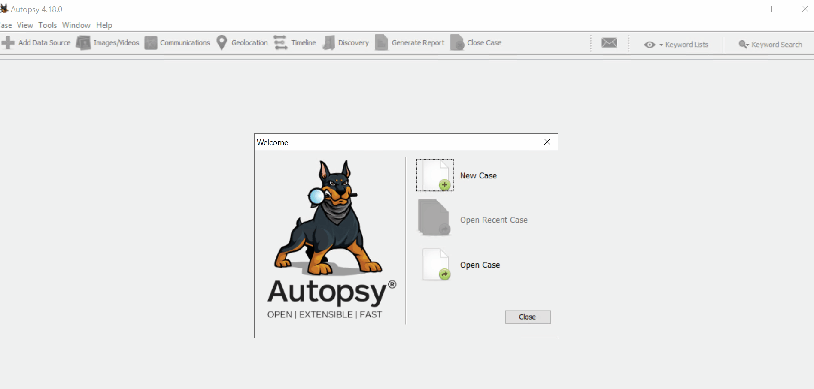

### Opening an existing case

Autopsy case files use the `.aut` extension. Select **Open Case**, navigate to the case folder on the Desktop, and select the `.aut` file.

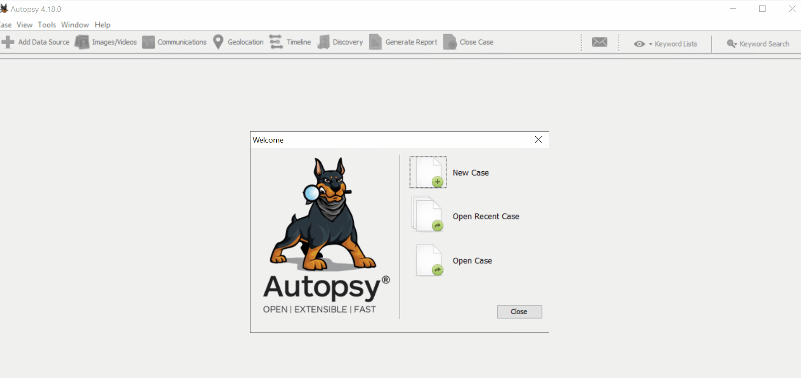

If Autopsy cannot locate the disk image, a warning box appears. You can point to the image location, or click **No** and still analyze the data held in the Autopsy case.

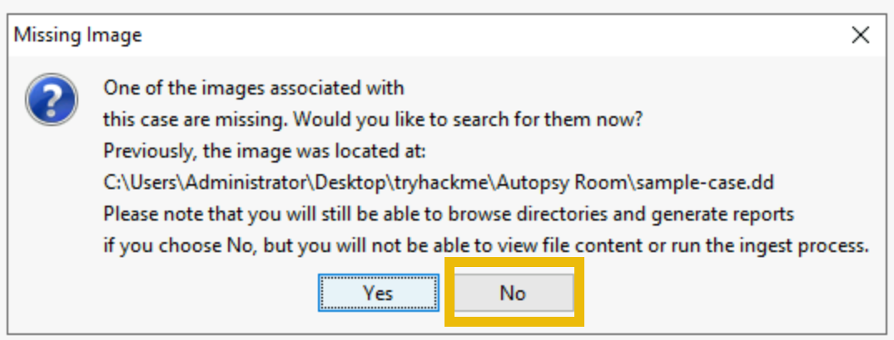

The case name is shown at the top left of the Autopsy window once a case is open.

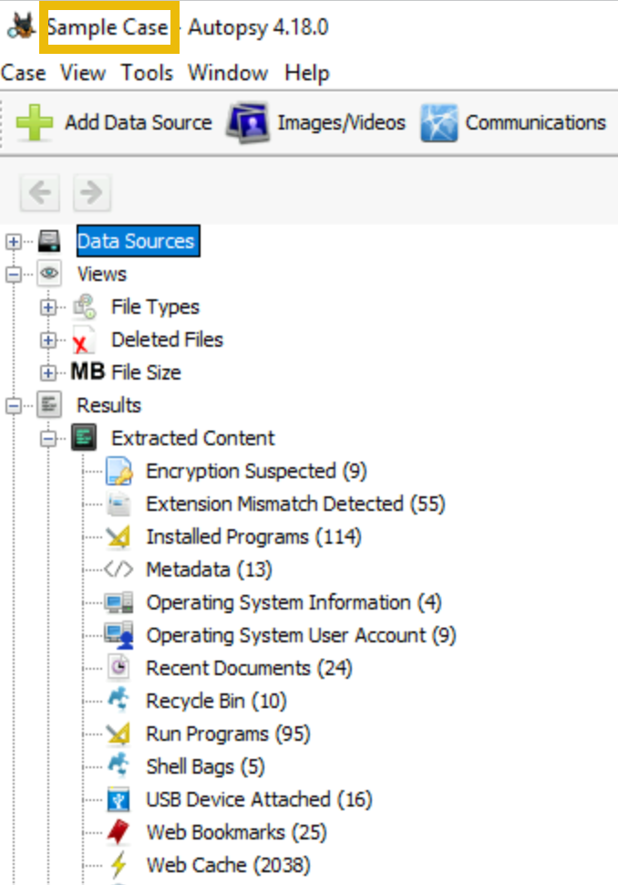

### Questions

**What is the file extension of the Autopsy files?**

```
.aut
```

---

## Task 3 — Data Sources

Data sources are added with the **Add Data Source** button. This room focuses on the **Disk Image or VM File** option.

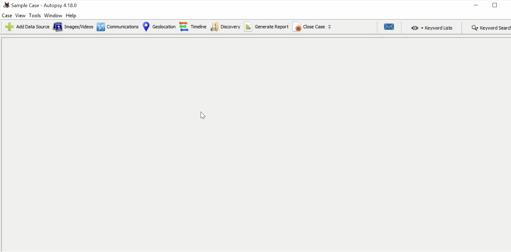

### Supported disk image formats

| Format | Examples |
|--------|----------|
| Raw Single | `*.img`, `*.dd`, `*.raw`, `*.bin` |
| Raw Split | `*.001`, `*.002`, `*.aa`, `*.ab` |
| EnCase | `*.e01`, `*.e02` |
| Virtual machines | `*.vmdk`, `*.vhd` |

💡 For multi-part images (E01, E02, E03, ...), Autopsy only needs to be pointed at the first image file; it handles the rest.

### Questions

**What is the disk image name of the "e01" format?**

```
EnCase
```

---

## Task 4 — Ingest Modules

Ingest Modules are essentially Autopsy plug-ins. Each one analyzes and retrieves specific data from the drive. By default they run on **All Files, Directories, and Unallocated Space**, and progress can be tracked from the bar in the lower right corner.

### Configuring ingest modules

**While adding a data source** — enable or disable modules during the add-data-source wizard.

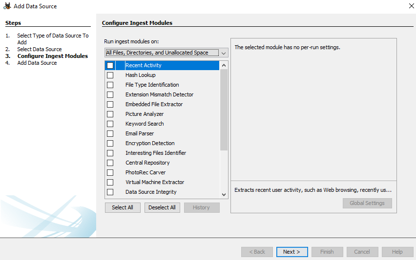

**After adding a data source** — on a pre-loaded disk:

1. Right-click the data source and open **Run Ingest Modules**
2. Choose the modules to run and click **Finish**
3. Track the progress

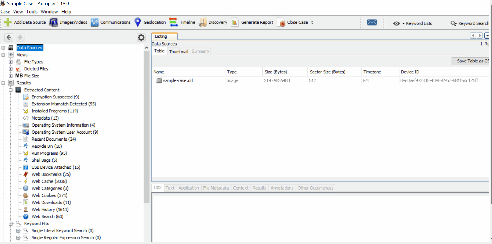

⚠️ The ingest modules have already been run on the lab machine. Running them again is resource-intensive and causes significant performance issues, so this room does not cover running them.

### Where results appear

Ingest module output populates the **Results** node in the Tree Viewer (left pane). Results depend on the dataset: if the drive holds no matching data, the module returns nothing. The example below uses the Interesting Files Identifier module.

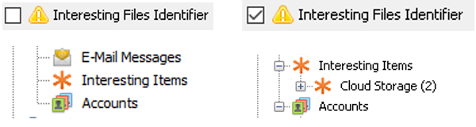

Some modules have **per-run settings** (marked with a yellow triangle in the Configure Ingest Modules window), such as Interesting Files Finder. Others, such as Keyword Search, do not.

As modules run, alerts may appear in the **Ingest Inbox**.

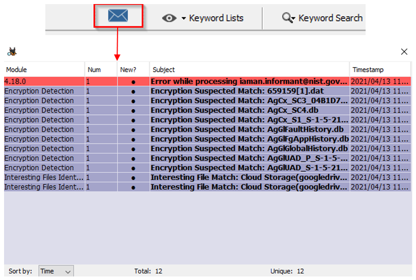

No questions in this task.

---

## Task 5 — The User Interface I

Autopsy's interface has five primary areas.

### Tree Viewer

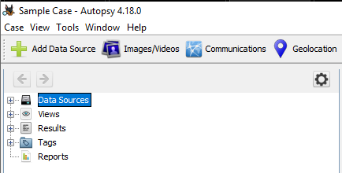

| Top-level node | Contents |
|----------------|----------|
| **Data Sources** | All data organized like a Windows File Explorer |
| **Views** | Files organized by file type, MIME type, file size, etc. |
| **Results** | Output from ingest modules |
| **Tags** | Files and/or results that have been tagged |
| **Reports** | Reports generated by modules or the analyst |

### Result Viewer

📌 Don't confuse the **Results** node (Tree Viewer) with the **Result Viewer**.

Selecting a volume, file, or folder in the Tree Viewer shows additional information about it in the Result Viewer.

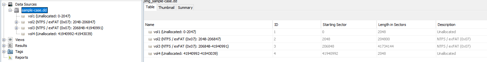

For a selected volume, the information reflects what is stored in the local database. Files can be extracted by right-clicking and selecting **Extract File(s)**.

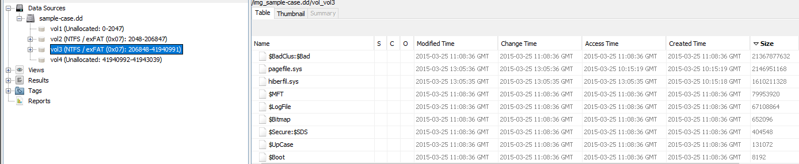

The Result Viewer has three tabs: **Table**, **Thumbnail**, and **Summary**. Thumbnail works best with image or video files; for other data, little information is shown.

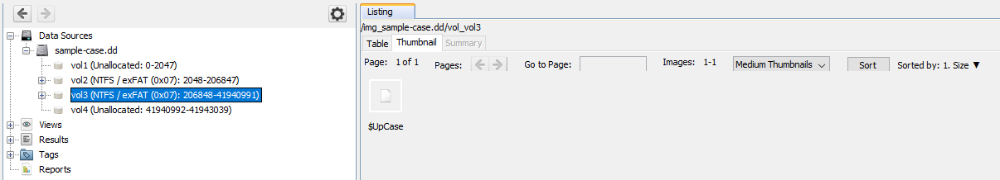

Volume nodes can be expanded and navigated like a typical Windows system.

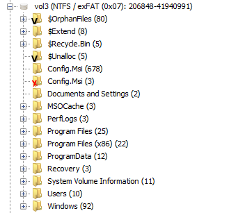

Under **Views**, files are categorized by **File Types**: By Extension, By MIME Type, By Deleted Files, and By File Size.

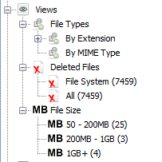

💡 **Tip:** An adversary can rename a file with a misleading extension. The file will then be miscategorized **By Extension** but categorized appropriately **By MIME Type**. Expanding By Extension reveals child nodes that categorize files further.

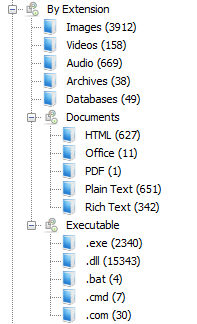

### Contents Viewer

Clicking a folder or file in the Result Viewer's Table tab displays additional information in the Contents Viewer.

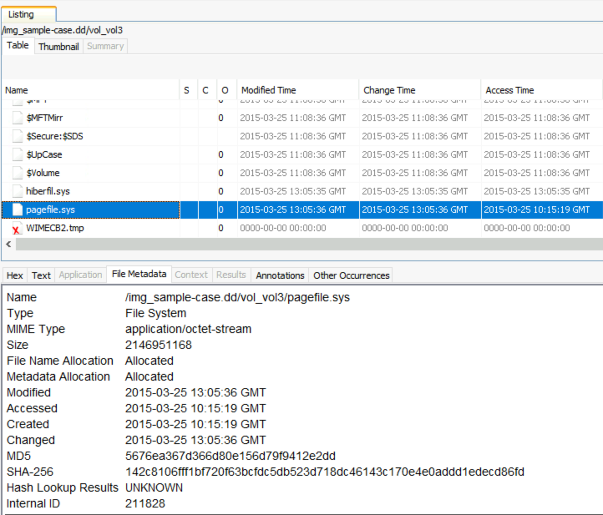

| Column | Meaning |
|--------|---------|
| **S — Score** | Red exclamation point = notable; yellow downward triangle = suspicious. Set by an ingest module or the analyst |
| **C — Comment** | A yellow page icon indicates a comment exists for the file/folder |
| **O — Occurrence** | How many times the file/folder has been seen in past cases (requires the Central Repository) |

### Keyword Search

At the top right are **Keyword Lists** and **Keyword Search**, which allow an analyst to perform an ad-hoc keyword search. The example searches for the word `secret`.

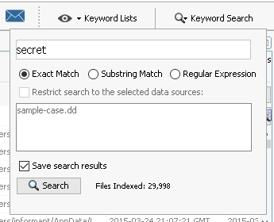

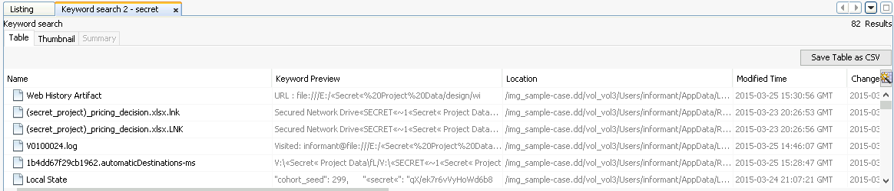

### Status Area

At the bottom right, the Status Area shows a progress bar and percentage while ingest modules run. Clicking the bar gives detailed ingest information; clicking the **X** next to it prompts to confirm cancelling the ingest modules.

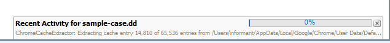

### Questions

**Expand the "Data Sources" option; what is the number of available sources?**

```
4
```

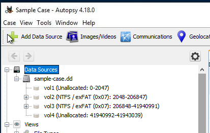

**What is the number of the detected "Removed" files?**

```
10
```

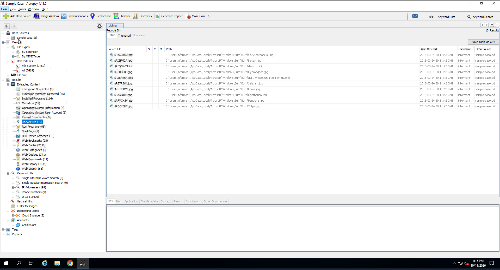

**What is the filename found under the "Interesting Files" section?**

```
googledrivesync.exe
```

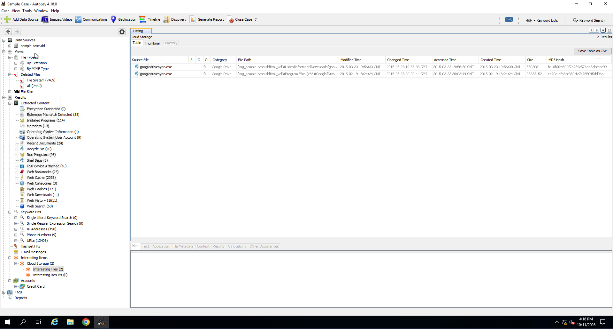

---

## Task 6 — The User Interface II

Summarized information helps an analyst decide where to focus. Viewing the summary of the data sources before starting an investigation gives a general idea of the system and its artifacts.

### Data Sources Summary

The Data Sources Summary provides summarized info in nine categories. It is an overview of total findings; to dig into a specific artifact, analyze each module separately using the Result Viewer.

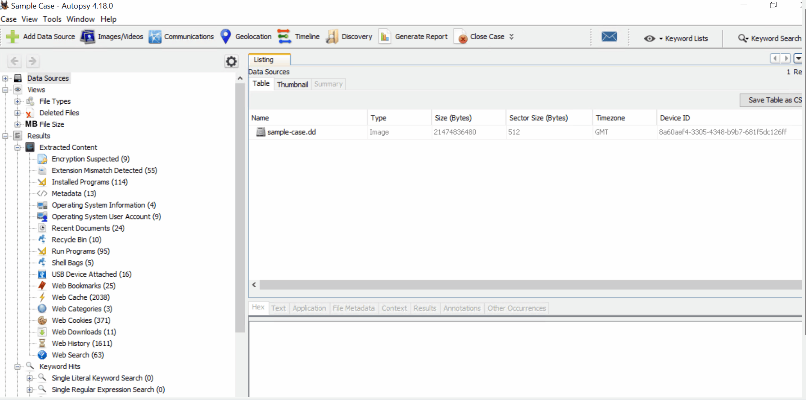

### Generate Report

Reports can be generated in multiple formats and contain everything listed under the Result Viewer pane. They have no additional search options, so artifacts of interest must be found manually.

💡 **Tip:** Autopsy can be heavy on low-resource systems, and browsing long results may freeze the system. Use Autopsy to parse the data and generate the report, then continue analysis from the report without Autopsy. The GUI is still easier for conducting and managing an investigation.

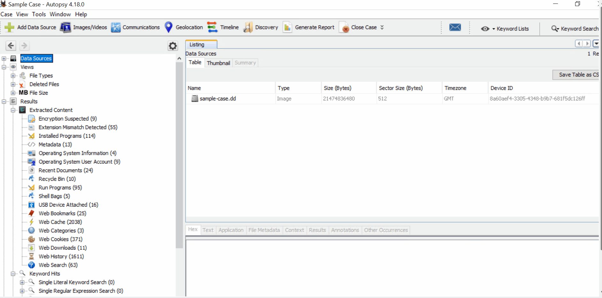

Once the format and scope are chosen, the report is generated. Clicking the **HTML Report** section opens it in a browser, with the Result Viewer results listed on the left side.

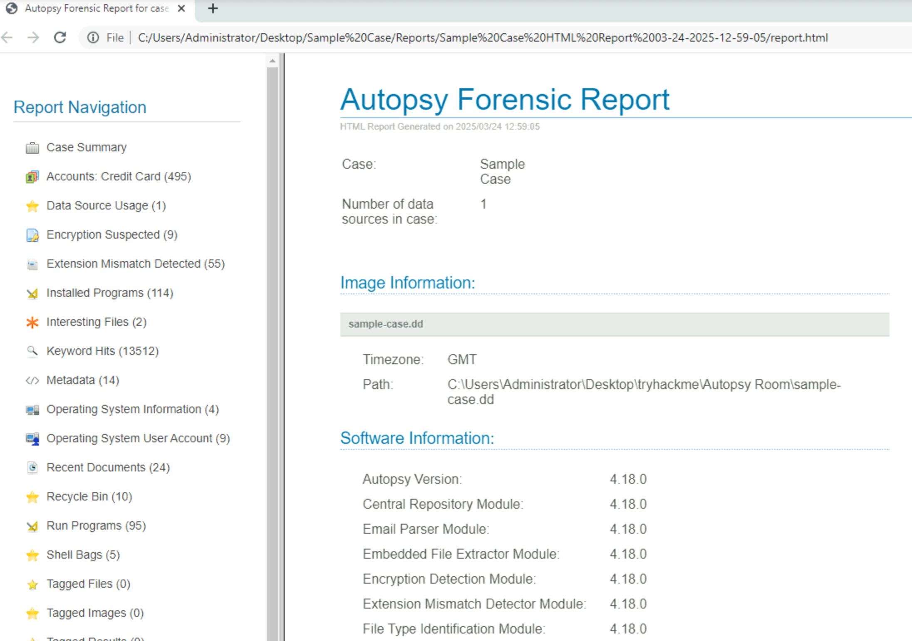

### Questions

**What is the full name of the operating system version?**

```
Windows 7 Ultimate Service Pack 1
```

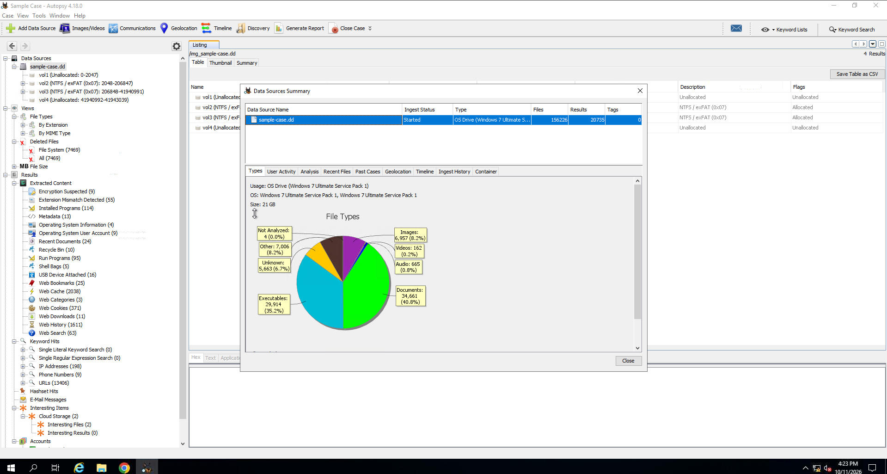

**What percentage of the drive are documents? Include the % in your answer.**

```
40.8%
```


**Generate an HTML report as shown in the task and view the "Case Summary" section. What is the job number of the "Interesting Files Identifier" module?**

```
10
```

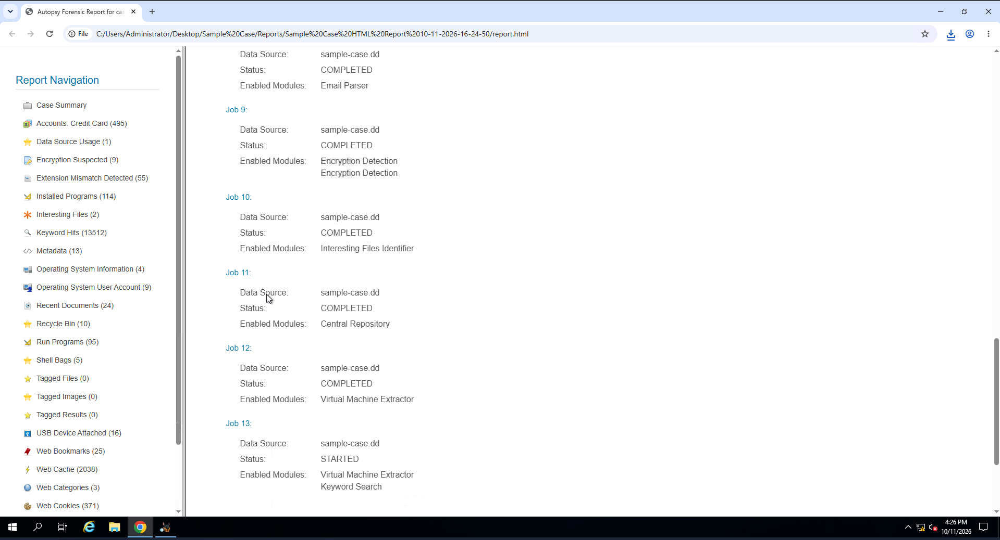

---

## Task 7 — Data Analysis

### Mini scenario

An employee was suspected of leaking company data. A disk image was retrieved from the machine, and the task is to perform the initial analysis. Further action will be determined from the initial findings.

📌 The actual disk image is not in the attached VM, so some Autopsy sections show only the metadata held in the local database. Click **No** when notified about the Missing Image. No ingest modules need to be run for this exercise.


### Questions

**What is the name of an Installed Program with the version number of 6.2.0.2962?**

```
Eraser
```

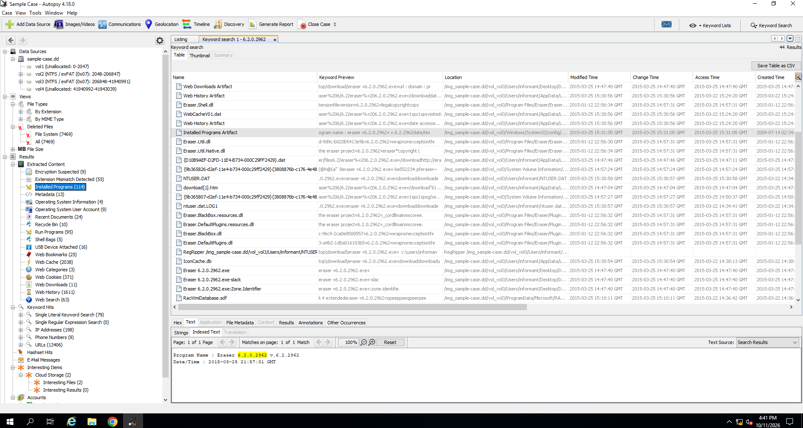

**A user has a Password Hint. What is the value?**

```
IAMAN
```

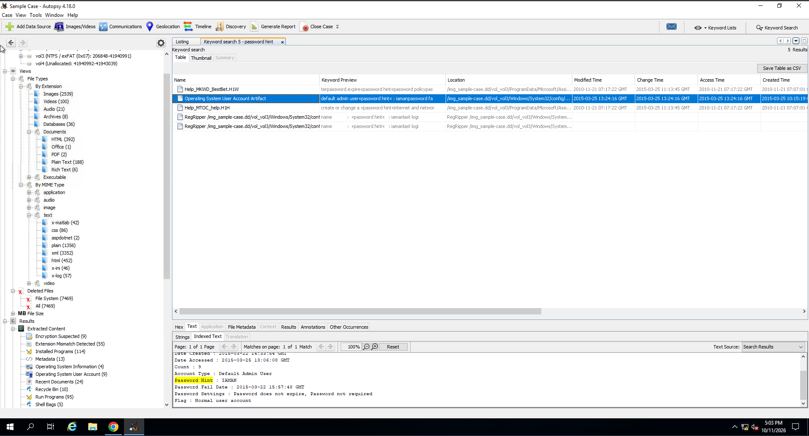

**Numerous SECRET files were accessed from a network drive. What was the IP address?**

```
10.11.11.128
```

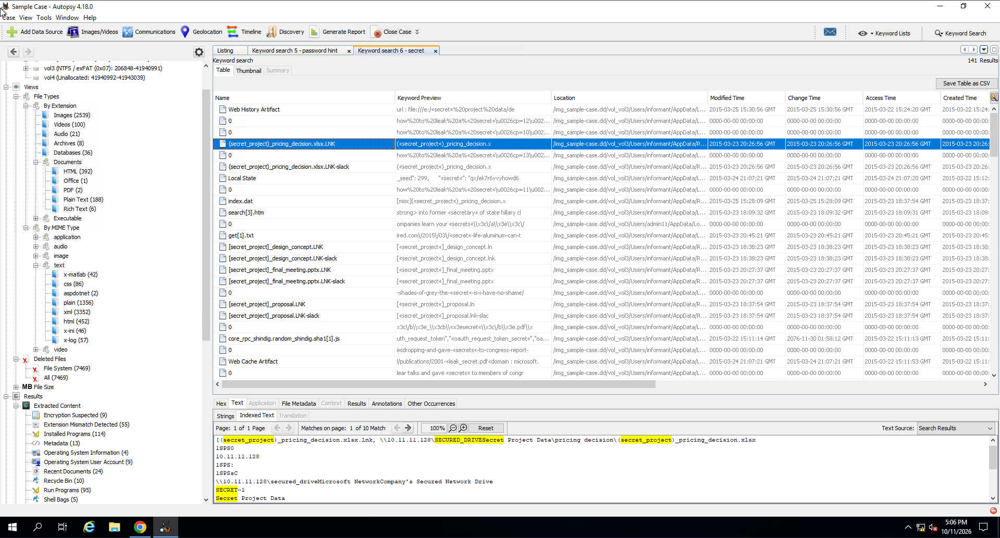

**What web search term has the most entries?**

```
information leakage cases
```

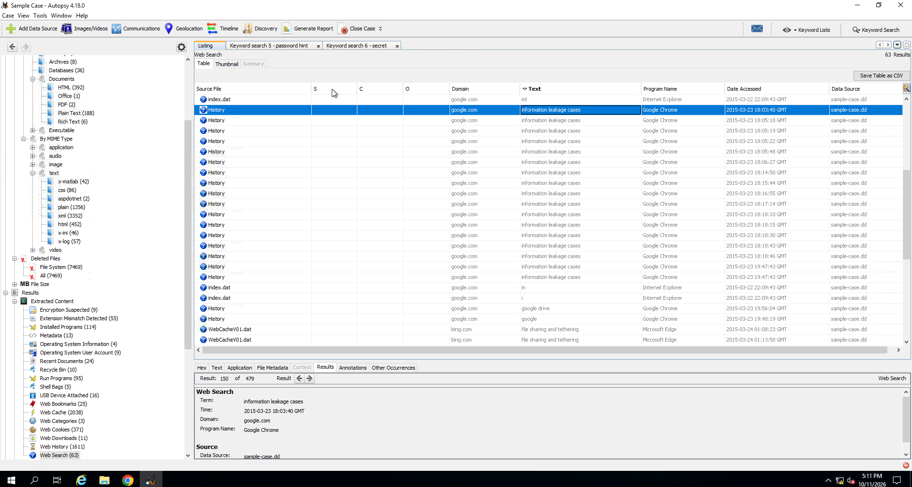

**What was the web search conducted on 3/25/2015 21:46:44?**

```
anti-forensic tools
```

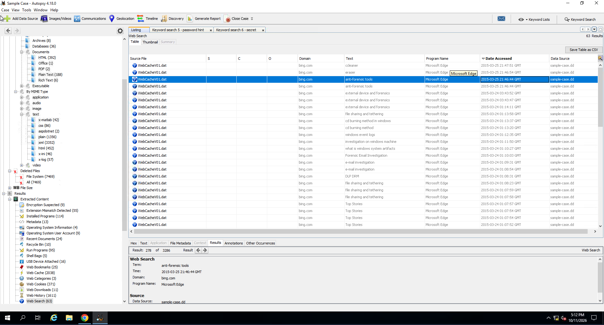

**What MD5 hash value of the binary is listed as an Interesting File?**

```
fe18b02e890f7a789c576be8abccdc99
```

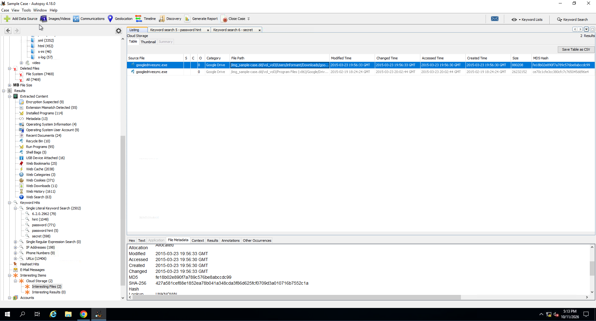

**What self-assuring message did the 'Informant' write for himself on a Sticky Note? (no spaces)**

```
Tomorrow...Everything will be OK...
```

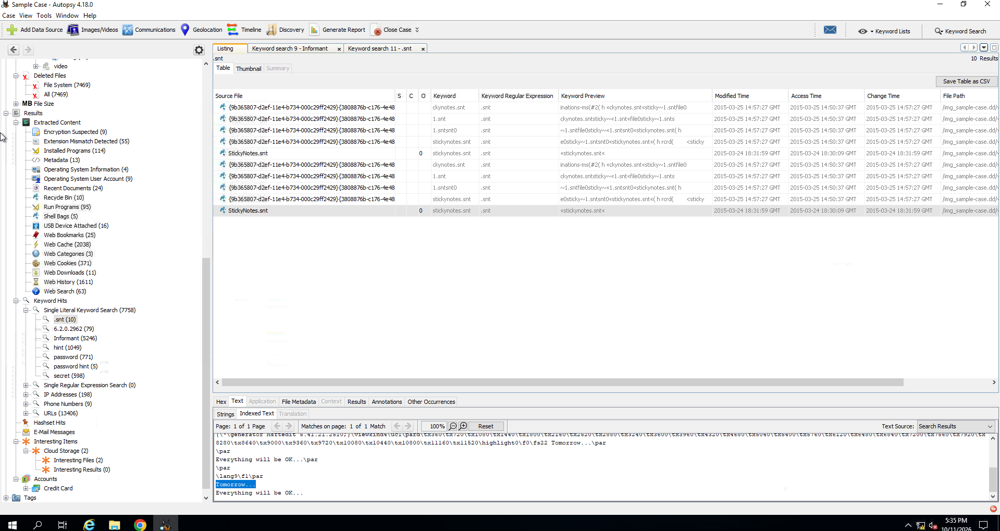

### Findings summary

| Artifact | Finding |
|----------|---------|
| Installed program (v6.2.0.2962) | `Eraser` |
| Password hint | `IAMAN` |
| Network drive hosting SECRET files | `10.11.11.128` |
| Most frequent web search | `information leakage cases` |
| Search at 3/25/2015 21:46:44 | `anti-forensic tools` |
| Interesting File binary MD5 | `fe18b02e890f7a789c576be8abccdc99` |
| Sticky Note message | `Tomorrow...Everything will be OK...` |

🔴 **Insider-threat relevance:** the scenario combines a suspected data leak with an installed program named `Eraser`, a web search for `anti-forensic tools`, and `googledrivesync.exe` flagged under Interesting Files (Task 5). These are the kind of artifacts to correlate when triaging a possible insider-threat case.

---

## Task 8 — Visualization Tools

Beyond the areas covered so far, Autopsy offers further visualization tools (documentation links below). Only **Timeline** can be practiced in the attached VM.

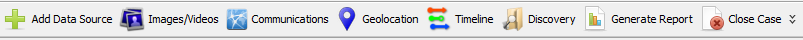

- [Images/Videos](http://sleuthkit.org/autopsy/docs/user-docs/4.12.0/image_gallery_page.html)
- [Communications](http://sleuthkit.org/autopsy/docs/user-docs/4.12.0/communications_page.html)
- [Timeline](http://sleuthkit.org/autopsy/docs/user-docs/4.12.0/timeline_page.html)

### Timeline

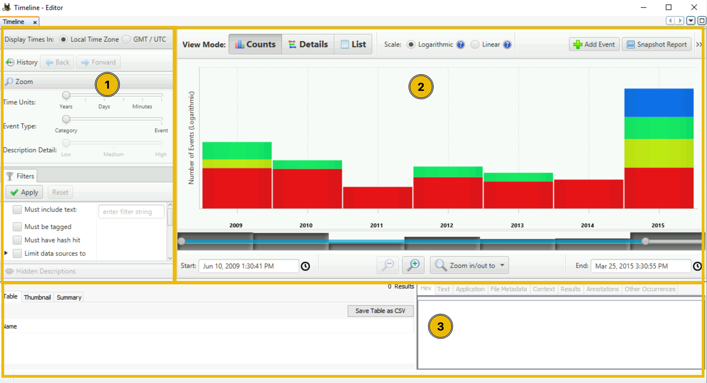

The Timeline tool has three areas:

| Area | Purpose |
|------|---------|
| **Filters** | Narrow the events displayed based on filter criteria |
| **Events** | Events displayed according to the View Mode |
| **Files/Contents** | Additional information on the selected event(s) |

| View mode | Display |
|-----------|---------|
| **Counts** | Number of events as a bar chart |
| **Details** | Event information, clustered and collapsed so the UI is not overloaded |
| **List** | Events in a table view |

The screenshot above shows Counts mode. Below is Details mode.

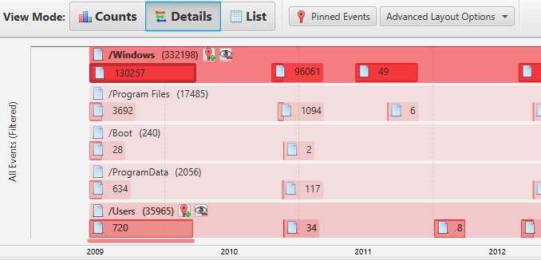

The numbers indicate how many events are clustered/collapsed for a time frame. For example, `/Windows` has 130,257 events between 2009-06-10 and 2010-03-18.

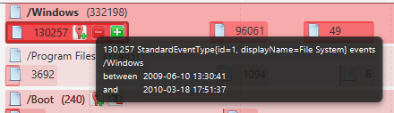

### Controlling clusters

| Icon | Action |
|------|--------|
| Green plus | Expand a cluster |
| Red minus | Collapse events |
| Map marker with plus | Pin a group of events to an isolated section of the Events view |
| Map marker with minus | Unpin events |
| Eye with minus | Hide a group of events (moved to Hidden Descriptions in Filters) |

Expanding a cluster:

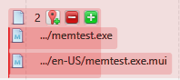

Pinning events:

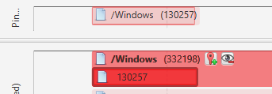

Hiding events — here the clustered events for `/Boot` were hidden and placed in Hidden Descriptions:

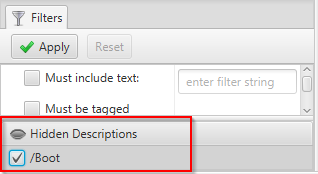

To reverse a hide, right-click and select **Unhide**, which removes them from the list:

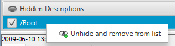

List view mode:

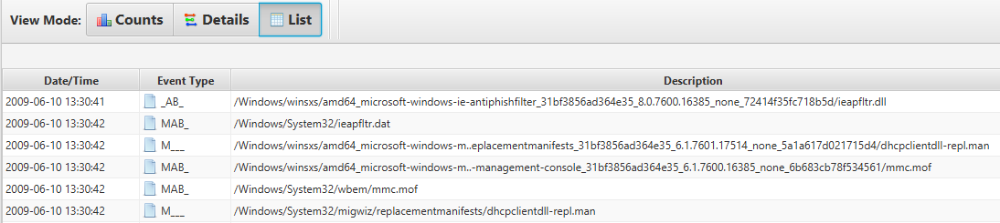

### Questions

**Using the Timeline, how many results were there on 2015-01-12?**

```
46
```

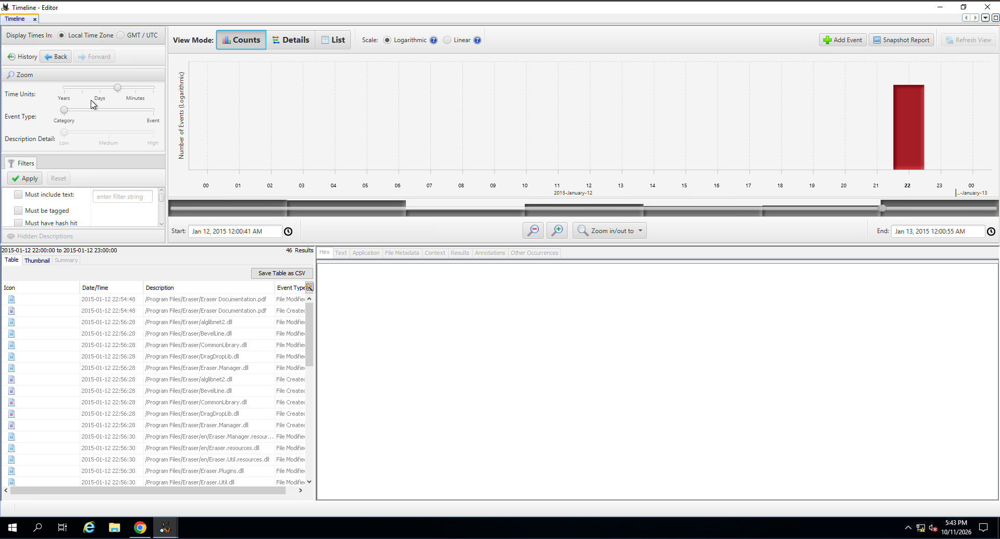

**The majority of file events occurred on what date? (MONTH DD, YYYY)**

```
March 25, 2015
```

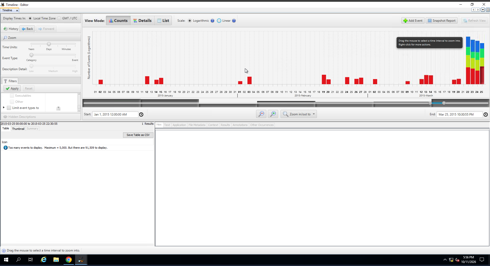

📌 Cross-reference: `March 25, 2015` is also the date of the `anti-forensic tools` web search from Task 7.

---

## Task 9 — Conclusion

Autopsy covers more than this room demonstrates. Topics suggested for further exploration to get more out of the box:

- Global Hash Lookup Settings
- Global File Extension Mismatch Identification Settings
- Global Keyword Search Settings
- Global Interesting Items Settings
- Yara Analyser
- [Third-party modules](https://github.com/sleuthkit/autopsy_addon_modules)

The disk image used in this room was created and released by NIST under the Computer Forensic Reference Data Sets (CFReDS) project, and the full [Data Leakage Case](https://www.cfreds.nist.gov/data_leakage_case/data-leakage-case.html) exercise is available for further practice.

---

## Key Takeaways

- Autopsy workflow: open/create case → add data source → run ingest modules → review artifacts → generate report.
- Case files use the `.aut` extension; for EnCase images (`.e01`, `.e02`, ...) only the first segment needs to be selected.
- Ingest modules are plug-ins whose output lands under the **Results** node; per-run settings are flagged with a yellow triangle.
- The UI has five areas: Tree Viewer, Result Viewer, Contents Viewer, Keyword Search, and Status Area.
- Compare **Views → By Extension** against **By MIME Type** to spot files renamed with a misleading extension.
- The Data Sources Summary gives a quick overview of OS, file categories, and artifacts before deep analysis.
- HTML reports let you continue analysis without the heavy Autopsy GUI, at the cost of search functionality.
- Timeline (Counts / Details / List) helps pinpoint the dates where file activity clusters — here, March 25, 2015.
- In the mini-scenario, installed software, web searches, network-drive access, and interesting files together pointed to a suspected data-leak case.

---

*Write-up by [OPT4RUN](https://tryhackme.com/p/OPT4RUN)*