# DiskFiltration

| | |
|---|---|
| **Room** | DiskFiltration |
| **Difficulty** | Hard |
| **Duration** | 120 min |
| **Link** | [https://tryhackme.com/room/diskfiltration](https://tryhackme.com/room/diskfiltration) |
| **Path** | Advanced Endpoint Investigations |
| **Module** | 7 — Disk Image Analysis |

---

## Overview

DiskFiltration is a capstone-style challenge for the Disk Image Analysis module. Rather than teaching a single tool, it asks you to combine Autopsy, registry analysis, NTFS artifacts, file carving, and Windows forensics on one already-ingested disk image from a suspected insider data-exfiltration case.

For a SOC/blue team analyst, this is a realistic insider-threat investigation: a terminated employee, a company-provided workstation, removable media, a personal hotspot used to dodge network-level monitoring, and an external accomplice supplying instructions. Every finding comes from the endpoint's disk image alone, so the room reinforces how much of an insider incident can be reconstructed from host artifacts when network telemetry is incomplete or deliberately evaded.

**Recommended prerequisites (per the room):** [Autopsy](https://tryhackme.com/room/btautopsye0), [Expediting Registry Analysis](https://tryhackme.com/room/expregistryforensics), [File Carving](https://tryhackme.com/room/filecarving), [NTFS Analysis](https://tryhackme.com/room/ntfsanalysis), [Windows Forensics 1](https://tryhackme.com/room/windowsforensics1), [Windows Forensics 2](https://tryhackme.com/room/windowsforensics2)

---

## Task 1 — Attack Chain

The room opens with an overview of the attack chain the investigation reconstructs. No questions are asked in this task.

| MITRE Tactic | Technique | Activity |
|---|---|---|
| Initial Access | [T1078](https://attack.mitre.org/techniques/T1078/) — Valid Accounts: Local Accounts | Liam used his valid credentials to log into his workstation. |
| Discovery | [T1083](https://attack.mitre.org/techniques/T1083/) — File and Directory Discovery | Liam searches for critical files in the file explorer. |
| Collection | [T1560](https://attack.mitre.org/techniques/T1560/) — Archive Collected Data: Archive via Utility | Liam copies the zip file from the USB to his workstation and unzips it. |
| Exfiltration | [T1048](https://attack.mitre.org/techniques/T1048/) — Exfiltration Over Alternative Protocol | Liam executes a file responsible for uploading any future data in the Documents folder to the external entity. |
| Defense Evasion | [T1070.004](https://attack.mitre.org/techniques/T1070/004/) — File Deletion | Liam deletes the extracted zip folder after performing the exfiltration. |
| Execution | [T1059.001](https://attack.mitre.org/techniques/T1059/001/) — Command and Scripting Interpreter: PowerShell | Liam executes a PowerShell command to get some information about the system as per the plan provided by the external entity helping him. |

> 📌 The table lists the techniques as the room presents them, which is not strictly chronological. Task 2 answers below let you place several of these steps on the timeline.

---

## Task 2 — The Exfiltration Hunt

### Scenario

Tech THM discovered that its critical data had been leaked to competitors. An internal investigation pointed to **Liam**, a recently terminated system engineer who had access to the leaked data on his company-provided workstation. He often worked late hours without clear justification and was caught roaming around the critical server room and photographing the entry gate. The initial investigation suggests an **external entity** was also helping him.

### Lab Setup

- Start the Lab Machine (split view, or RDP with the credentials provided in the room).
- The already-ingested case is located at `C:\Users\Administrator\Documents\New Folder\Liam's Disk\` and opens in **Autopsy**.
- Supporting tools are on the desktop inside the **Forensic Tools** folder.

---

### Q1 — USB device serial number

**What is the serial number of the USB device Liam used for exfiltration?**

```
2651931097993496666
```

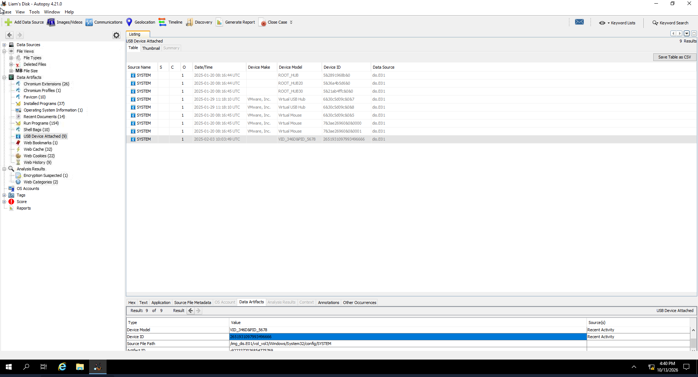

---

### Q2 — Personal hotspot profile

**What is the profile name of the personal hotspot Liam used to evade network-level detection?**

```
Liam's Iphone
```

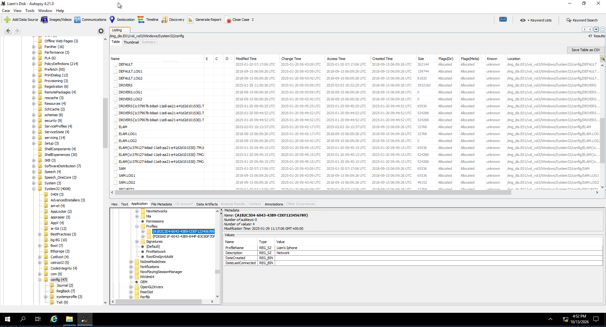

> 🔴 A personal hotspot sidesteps corporate network monitoring entirely, so the host's own artifacts become the main evidence of the connection.

---

### Q3 — Zip file copied from the USB

**What is the name of the zip file Liam copied from the USB to the machine for exfiltration instructions?**

```
Shadow_Plan.zip
```

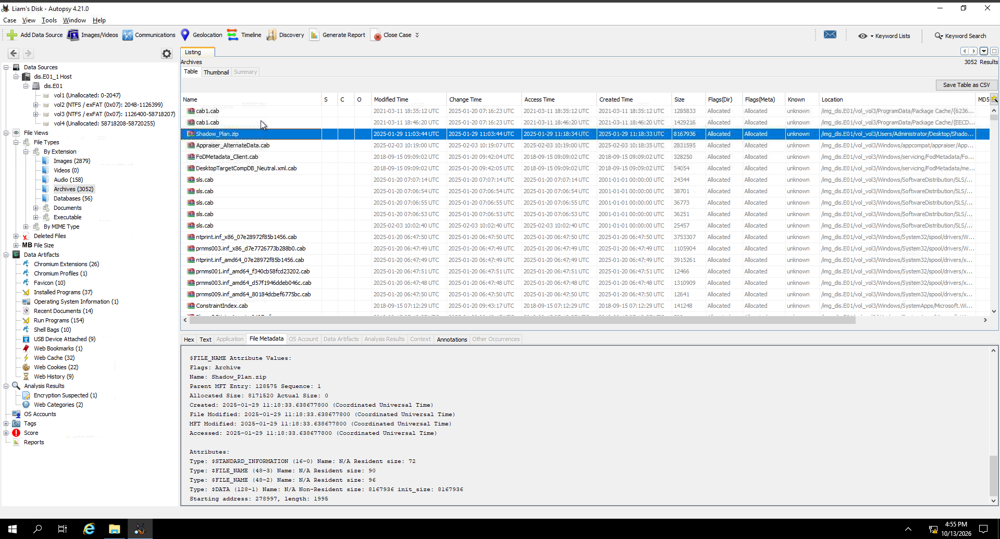

---

### Q4 — Zip password

**What is the password for this zip file?**

```
Qwerty@123
```

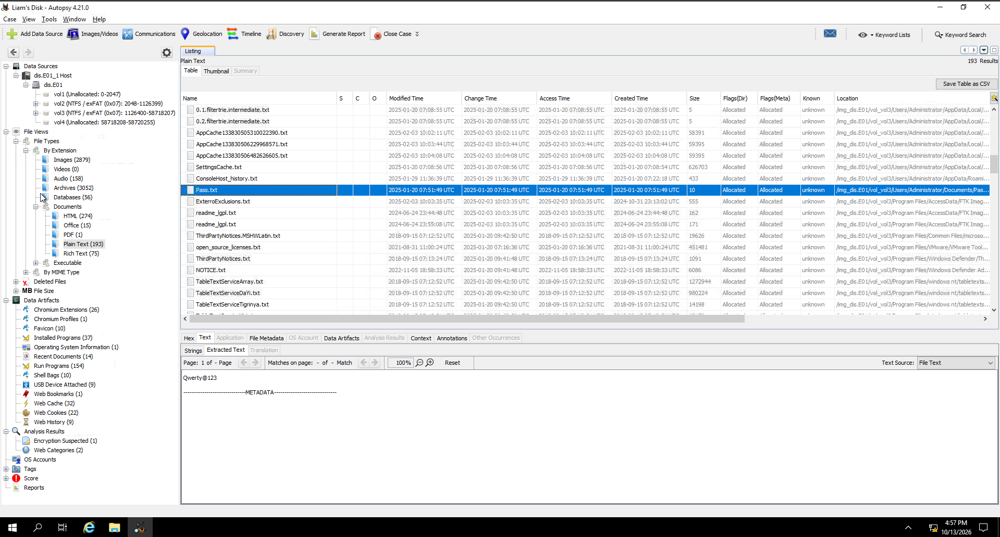

---

### Q5 — Author of the PDF

**Time to reveal the external entity helping Liam! Who is the author of the PDF file stored in the zip file?**

```
Henry
```

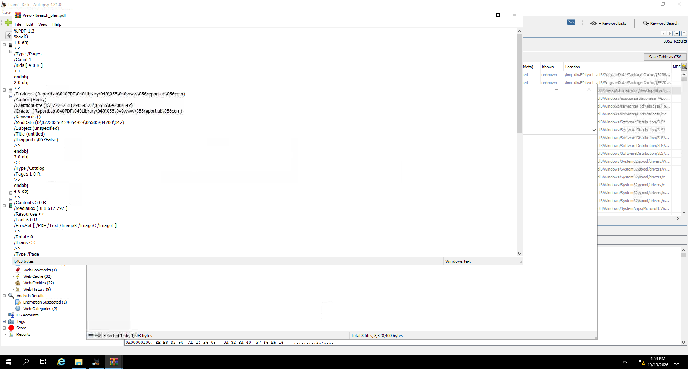

---

### Q6 — File with no extension

**What is the correct extension of the file that has no extension in the zip folder?**

```
PNG
```

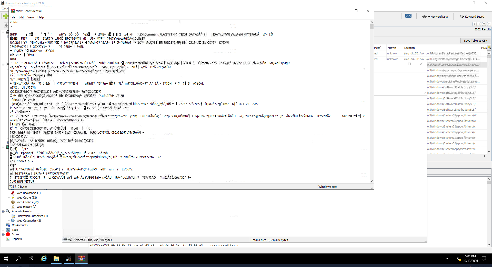

---

### Q7 — File Explorer searches

**It looks like Liam searched for some files inside the file explorer. What are the names of these files? (alphabetical order)**

```
Financial, Revenue
```

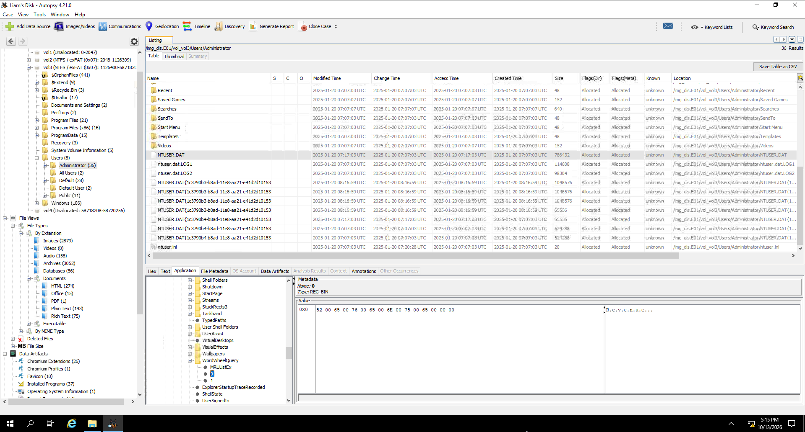

> 💡 These searches map to the Discovery step (T1083) in the attack chain.

---

### Q8 — Folders on the USB device

**What are the names of the folders that were present on the USB device? (alphabetical order)**

```
Critical Data TECH THM, Exfiltration Plan
```

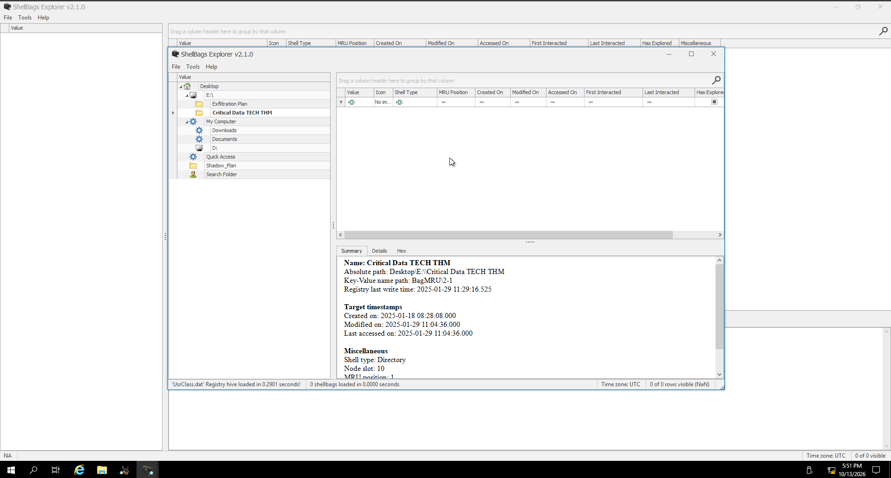

---

### Q9 — file_uploader.exe execution

**The external entity didn't fully trust Liam for the exfiltration, so they asked him to execute `file_uploader.exe` through the instructions in the PDF. When was this file last executed and how many times was it executed? (YYYY-MM-DD HH:MM:SS, number of execution times)**

```
2025-01-29 11:26:09, 2
```

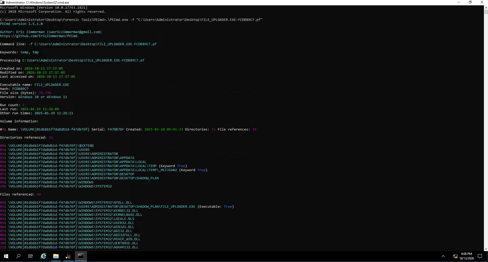

> 🔴 Per the attack chain, this executable uploads any future data placed in the Documents folder to the external entity — a persistent exfiltration channel (T1048) rather than a one-off copy.

---

### Q10 — Hidden flag

**Liam received a hidden flag inside a file (in the zip folder) from the external entity helping him. What was that?**

```
FLAGT{THM_TECH_DATA}
```


> 📌 The same screenshot (`task2-06.png`) supports both Q6 and Q10: the file with no extension, once identified as a PNG, is the one carrying the flag.

---

### Q11 — Tax Records.docx deletion

**It seems like Liam caused one last damage before leaving. When did Liam delete "Tax Records.docx"? (YYYY-MM-DD HH:MM:SS)**

```
2025-01-29 11:29:02
```

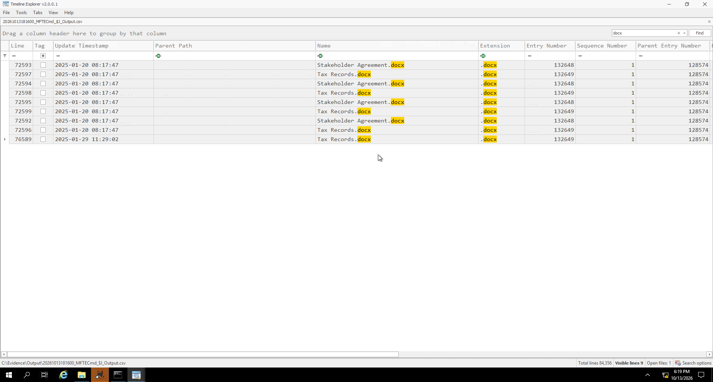

> 🔴 File deletion maps to T1070.004 (Defense Evasion).

---

### Q12 — Social media site searched in the browser

**Which social media site did Liam search for using his web browser? Likely to avoid suspicion, thinking somebody was watching him. (Full URL)**

```
https://www.facebook.com/
```

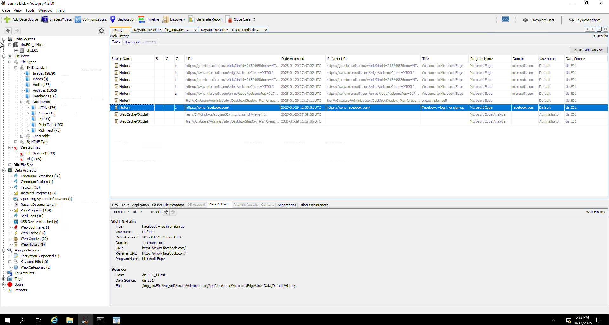

---

### Q13 — PowerShell command executed

**What is the PowerShell command Liam executed as per the plan?**

```
Get-WmiObject -Class Win32_Share | Select-Object Name, Path
```

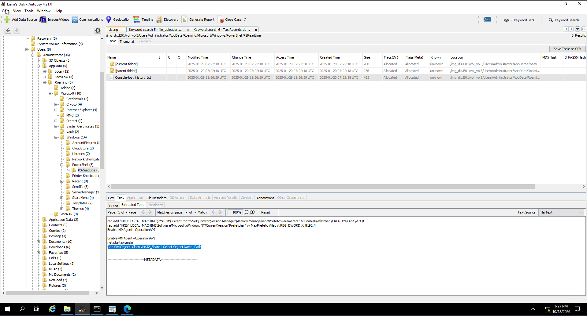

The execution plan inside `shadow_plan.zip` was to enumerate all of the network shares on the system, which is exactly what `Win32_Share` returns.

---

## Reconstructed Timeline

Only the timestamps recovered in the room are shown.

| Time (as recorded) | Event |
|---|---|
| 2025-01-29 11:26:09 | `file_uploader.exe` last executed (2 executions in total) |
| 2025-01-29 11:29:02 | `Tax Records.docx` deleted |

## Findings Summary

| Item | Finding |
|---|---|
| USB serial number | `2651931097993496666` |
| Hotspot profile | `Liam's Iphone` |
| Instruction archive | `Shadow_Plan.zip` (password `Qwerty@123`) |
| External entity (PDF author) | Henry |
| Extensionless file | PNG (contains the hidden flag) |
| Searched in File Explorer | Financial, Revenue |
| USB folders | `Critical Data TECH THM`, `Exfiltration Plan` |
| Uploader executable | `file_uploader.exe` — last run 2025-01-29 11:26:09, 2 runs |
| Deleted document | `Tax Records.docx` at 2025-01-29 11:29:02 |
| Browser search | `https://www.facebook.com/` |
| PowerShell command | `Get-WmiObject -Class Win32_Share \| Select-Object Name, Path` |

---

## Key Takeaways

- Insider exfiltration can be reconstructed from a single disk image: removable-media history, network profiles, execution evidence, browser activity, and deletion records all live on the endpoint.
- A personal hotspot defeats network-level monitoring, so host artifacts (saved wireless profiles) are what reveal the evasion.
- USB serial numbers tie a specific physical device to the incident, and the folder and file names found on it expose the accomplice's staging.
- Execution counts and last-run times for a suspicious executable such as `file_uploader.exe` help separate a one-off run from repeated use.
- Archive metadata (a PDF author) and a file with a missing extension can both identify the external party and hide data, so check document properties and file signatures, not just file names.
- Deletion timestamps, such as that of `Tax Records.docx`, show an insider's last actions before leaving and map to T1070.004.
- This room ties together Autopsy, registry analysis, NTFS artifacts, file carving, and Windows forensics in one end-to-end investigation.

---

*Write-up by OPT4RUN*