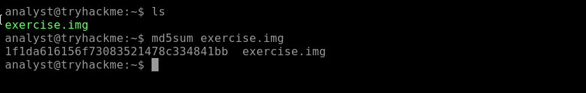
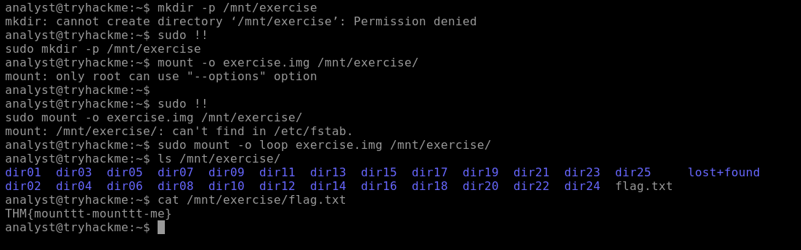
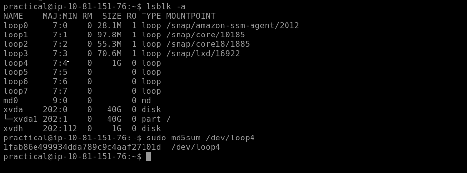
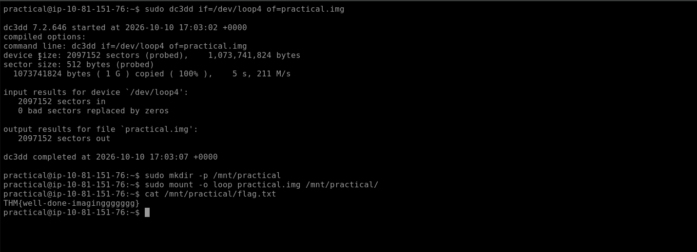

# Forensic Imaging

| Field | Details |
|---|---|
| **Room** | Forensic Imaging |
| **Difficulty** | Easy |
| **Duration** | 45 min |
| **Link** | [tryhackme.com/room/forensicimaging](https://tryhackme.com/room/forensicimaging) |
| **Path** | Advanced Endpoint Investigations |
| **Module** | Module 7 – Disk Image Analysis |

---

## Overview

Forensic imaging is the creation of an exact, bit-by-bit copy of digital storage media, capturing deleted files, hidden files, and unallocated space. For SOC and DFIR analysts, the image is the working copy: the original evidence stays untouched while the investigation runs against a verifiable duplicate. This room walks through the full acquisition workflow on a Linux host: identify the target device, create a raw image with `dc3dd`, verify integrity by hashing, and mount the image to confirm it is usable.

**Learning objectives**

- Learn the basics of the forensic imaging process
- Explore different environment settings for imaging
- Create a raw image from an attached device
- Perform an integrity check of an image

**Prerequisites:** Intro to Digital Forensics, DFIR: An Introduction, Linux Fundamentals 1, Legal Considerations in DFIR.

> 📌 Performance and timing considerations are intentionally out of scope in this room. The focus is the process itself.

---

## Task 1 – Introduction

Imaging serves two goals:

- Produce a **verifiable, reliable copy** usable in investigations and legal proceedings.
- Support the **chain of custody** by documenting how evidence is handled and transferred, demonstrating it was preserved and not tampered with.

No questions in this task.

---

## Task 2 – Preparation

### Environment

Linux is used to acquire the data. Open-source tooling helps satisfy guidelines for evidential reliability, and the Linux kernel supports a wide range of file systems, which is useful across different media types. The lab machine is reachable through the split-screen view or over SSH as user `analyst`.

### Write-blockers

A write-blocker is a device that prevents any modification to data on a storage device during analysis. It physically intercepts the write commands sent between the disk being imaged and the OS attached to it. Write-blockers are usually required when handling physical disks.

### Audit trail

An audit trail is a chronological record of actions and events, providing traceability for each step. The required level of detail depends on the legal or compliance framework in play.

Recommended bash settings for logging the session:

| Command | Purpose |
|---|---|
| `set -o history` | Enables command history recording |
| `shopt -s histappend` | Appends to the history file instead of overwriting it on shell exit |
| `export HISTCONTROL=` | Clears settings that control which commands are saved |
| `export HISTIGNORE=` | Clears patterns of commands that would be ignored |
| `export HISTFILE=~/.bash_history` | Sets the file where history is saved |
| `export HISTFILESIZE=-1` | No limit on lines stored in the history file |
| `export HISTSIZE=-1` | No limit on commands retained in the shell history |
| `export HISTTIMEFORMAT="%F-%R "` | Adds a timestamp to each history entry |

Additional logging practices:

- Log whole sessions with [`script`](https://man7.org/linux/man-pages/man1/script.1.html) or similar tools such as [`ttyrec`](https://github.com/mjording/ttyrec).
- Save the output of every command to a file where possible.

> 💡 Logging requirements can become more demanding depending on the legal framework and the needs of the investigation.

### Identifying the target device

Drives are attached as devices under `/dev`. The OS disk shows as `/dev/root` in `df`, but the target device is a virtual disk on a loop interface, so it does **not** appear in `df`. This is also common for physical disks that are not directly mounted.

List all block devices:

```bash
lsblk -a
```

In the room output, `loop11` shows 1.1 GB, matching the target disk size. Also confirm there is enough free space for the image: the OS partition (`xvda1`) is 40 GB.

> 💡 Loop device numbers can change between VM instances. Identify the target by its 1.1 GB size rather than by name.

Get more detail on the loop device (backing file, sector size):

```bash
sudo losetup -l /dev/loop11
```

Get the UUID and file system type:

```bash
sudo blkid /dev/loop11
```

Result in the room: ext4 file system on `/dev/loop11`.

> 📌 For physical disks, a command like `hdparm` can retrieve manufacturer, serial number, and other details that should be recorded in the notes before imaging.

### Questions

**What command can be used to list all block devices in Linux OS?**

```
lsblk
```

**Which bash command displays all commands executed in a session?**

```
history
```

---

## Task 3 – Creating a Forensic Image

The image is written as a raw file with the `.img` extension. Writing to another disk is also common practice, but the room writes to a local file.

### Common imaging tools

| Tool | Description |
|---|---|
| `dd` | Standard Unix utility for copying and converting files, often used for raw disk images |
| `dc3dd` | Enhanced `dd` with forensic features, including hashing and logging |
| `ddrescue` | Data recovery tool that copies from damaged drives, rescuing as much data as possible |
| FTK Imager | GUI-based tool, widely used for ease of use and comprehensive features |
| Guymager | GUI-based tool supporting various image formats with detailed logs |
| EWF tools (`ewfacquire`) | Create and handle Expert Witness Format (EWF) images |

### Imaging with dc3dd

```bash
sudo dc3dd if=/dev/loop11 of=example1.img log=imaging_loop11.txt
```

| Option | Meaning |
|---|---|
| `if` | Input file: the device to copy (`/dev/loop11`) |
| `of` | Output file: where the bytes are written (`example1.img`) |
| `log` | Saves all output to a log file (`imaging_loop11.txt`) |

Key results from the run: 2,252,800 sectors in, 0 bad sectors replaced by zeros, 2,252,800 sectors out. The device is 1,153,433,600 bytes with 512-byte sectors.

Confirm the output file has the same size as the source:

```bash
ls -alh example1.img
```

> 💡 The `log=` option gives a ready-made record of the acquisition for the audit trail.

No questions in this task.

---

## Task 4 – Integrity Checking

Integrity checking confirms the forensic copy is identical to the original using cryptographic hashes (MD5, SHA-1, SHA-256). Matching hashes for the source and the copy show the evidence was not altered during imaging, preserving reliability and admissibility.

- Tools such as `dc3dd` can calculate and verify hashes during imaging.
- Regular integrity checks throughout the investigation help preserve the chain of custody.

Verify manually by hashing both the image and the source device. The results must match:

```bash
sudo md5sum example1.img
sudo md5sum /dev/loop11
```

Both returned `483ca14c7524b8667974a922662b87e8`, so the integrity check passed.

### Questions

**What is the MD5 hash of the image "exercise.img" located in /home/analyst/?**

```
1f1da616156f73083521478c334841bb
```



---

## Task 5 – Other Types of Imaging

Imaging is not limited to disk devices:

| Type | Description |
|---|---|
| Remote imaging | Creates an image over the network, without physical access to the device |
| USB images | Creates an image of a USB drive's contents |
| Docker images | Not strictly an image: a snapshot of a container's file system and configuration |

### Mounting an image to verify it

Mounting confirms the image is usable. First, confirm the device is not mounted (`df -h`), then create a mount point and mount the image through a loop device:

```bash
sudo mkdir -p /mnt/example1
sudo mount -o loop example1.img /mnt/example1
ls /mnt/example1/
```

The listing shows `dir01` to `dir25` and `lost+found`, confirming the image is readable.

### Questions

**Mount the image "exercise.img" located in the analyst home directory folder. What is the content of the file "flag.txt" located within exercise.img?**

```
THM{mounttt-mounttt-me}
```



---

## Task 6 – Practical Exercise

A separate lab machine (user `practical`) hosts a 1 GB loop device. The Task 2 VM must be turned off before starting it. The workflow is the one from the earlier tasks: identify the loop device, image it with `dc3dd`, hash the result, and mount the image.

### Questions

**Create an image of the attached 1gb loop device. What is the MD5 hash of the image?**

```
1fab86e499934dda789c9c4aaf27101d
```



**Mount the image from the 1 GB loop device. What is the content of the file "flag.txt"?**

```
THM{well-done-imaginggggggg}
```



---

## Task 7 – Conclusion

The room covered the core imaging concepts and put them into practice: imaging devices, mounting the images, and verifying integrity through hashing. Suggested follow-up rooms: Linux Forensics, Linux Fundamentals 2, Linux Logs Investigations.

---

## Workflow Summary

| Step | Action | Command |
|---|---|---|
| 1 | Log the session | `script` / bash history settings |
| 2 | Identify the device | `lsblk -a`, `losetup -l`, `blkid` |
| 3 | Check free space for the image | `lsblk`, `df` |
| 4 | Acquire the image | `dc3dd if=… of=… log=…` |
| 5 | Verify integrity | `md5sum` on image and source |
| 6 | Confirm the image is usable | `mount -o loop` |

---

## Key Takeaways

- A forensic image is a bit-for-bit copy that includes deleted files, hidden files, and unallocated space.
- Use a write-blocker on physical disks so the source cannot be modified.
- Log everything: shell history settings, session recording with `script`, and saved command output form the audit trail.
- Record device details (size, UUID, file system type) before imaging, and confirm there is enough free space for the image.
- `dc3dd` extends `dd` with hashing and logging, which suits forensic acquisition.
- Always verify by hashing the image and the source: matching hashes confirm a faithful copy.
- Mount the image to confirm it is usable before moving on to analysis.

---

*Write-up by OPT4RUN*