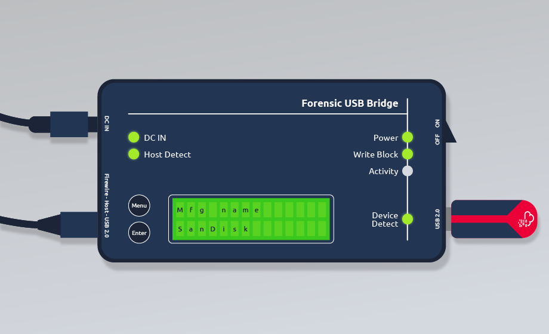
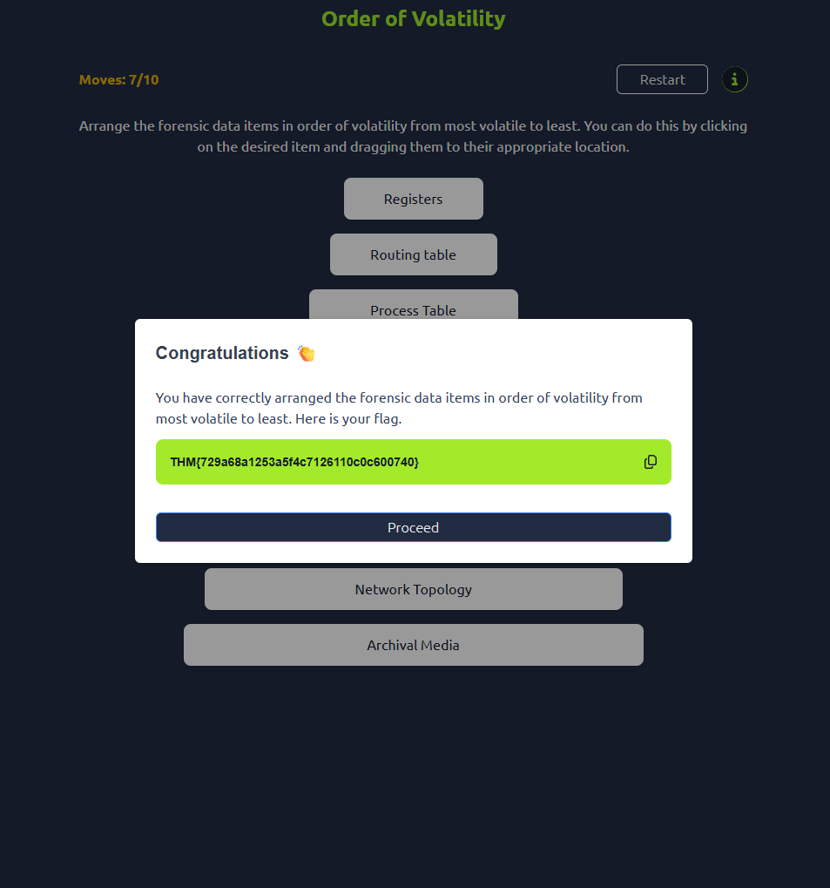
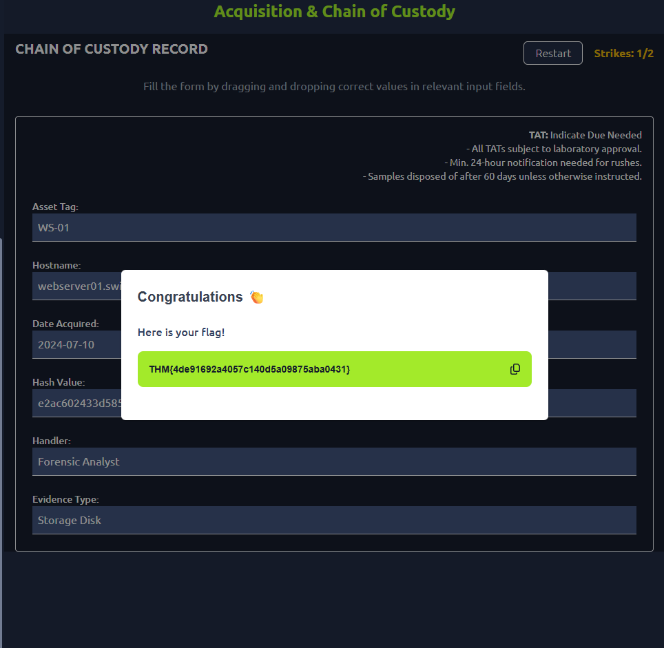

# 🧊 Intro to Cold System Forensics

| Field | Details |
|-------|---------|
| **Room** | Intro to Cold System Forensics |
| **Difficulty** | Easy |
| **Duration** | 60 min |
| **Link** | [tryhackme.com/room/introtocoldsystemforensics](https://tryhackme.com/room/introtocoldsystemforensics) |
| **Path** | Advanced Endpoint Investigations |
| **Module** | Disk Image Analysis |
| **Author** | [OPT4RUN](https://tryhackme.com/p/OPT4RUN) |

---

## Overview

This room opens the **Disk Image Analysis** module. It introduces **cold system forensics**: the examination of dormant or powered-off systems, and how DFIR teams preserve and analyse evidence from them.

For SOC and blue team analysts, the key value is knowing **when to go cold**. Live response is faster and captures volatile data, but it risks altering evidence. Cold analysis trades speed and volatile data for evidence integrity, a complete bit-for-bit capture, and a defensible chain of custody.

**Objectives**

- Learn the differences between live and cold system forensics
- Explore the challenges and opportunities of examining offline systems
- Understand the process and considerations for acquiring and preserving data from cold systems
- Get a brief introduction to common tools and when each applies

---

## Task 1 — Introduction

Task 1 is a scope-setting task with no questions. It covers live vs. cold forensics, data acquisition techniques, forensic tools, and legal considerations such as chain of custody and data volatility.

---

## Task 2 — Challenges and Opportunities

### Historical Context

Cold system forensics emerged as a direct response to the **cold boot attack**. Data in RAM persists briefly after power-off, and the cooler the RAM chips, the longer it lasts. Attackers could rapidly reboot a machine and recover encryption keys, passwords, or in-memory data before it decayed. Researchers responded by developing methods to preserve and analyse a system's contents when powered off.

### Beyond Memory Analysis

What began as memory-focused work now covers the **entire dormant system**: storage drives, peripherals, hardware configuration, and residual data in volatile memory. Examining a powered-off system preserves evidence integrity and prevents tampering, which matters most where admissibility depends on the evidence being unaltered.

### Cold vs. Live Forensics

| Aspect | Cold Forensics | Live Forensics |
|--------|----------------|----------------|
| System State | Examines powered-off systems | Examines running systems |
| Evidence Integrity | Minimal risk | High risk |
| Data Capture | Comprehensive capture of entire drives | Limited to active data |
| Volatile Memory Access | Cannot retrieve | Captures volatile data (memory, network) |
| Time Efficiency | Time-consuming | Faster identification of threats |
| Data Volume Handling | Suitable for large data volumes | Limited by system resources |
| Legal Suitability | Ideal where integrity is paramount | May alter evidence, less suitable for legal cases |
| Access to Encrypted Files | Risk of losing access if passwords are reset | Immediate access while the system is running |

### Common Scenarios for Cold System Forensics

| Scenario | Why Cold Analysis Fits |
|----------|------------------------|
| Risk of modifying evidence | Interacting with a live system can overwrite volatile data or change file timestamps |
| Comprehensive data capture | A bit-by-bit image captures everything, including deleted files (e.g. financial fraud cases) |
| Incident response | Shutting down a compromised host preserves evidence, though critical services may force live response first, with cold analysis later on a cloned image |
| Legal proceedings | Courts require a clear chain of custody and unaltered data (e.g. intellectual property theft) |
| Data recovery / file carving | Deleted or lost files can be reconstructed from disk images |
| Legacy systems | Outdated or unstable systems (e.g. older industrial control systems) may not support live tools |
| Cloud and virtualised environments | VM snapshots can be analysed without disrupting running services |

> 💡 **Tip:** In large environments running critical services, the practical pattern is **live response first, cold analysis on a cloned image afterwards**. This avoids service disruption without losing data.

### Questions

**Under what two system states are cold system forensics mainly applied?**

```
Dormant or Powered-off
```

**What type of attack provided a research basis for cold system forensics?**

```
cold boot attack
```

---

## Task 3 — Data Acquisition and Preservation

### Order of Volatility

The **order of volatility** defines the sequence for collecting evidence, capturing the most ephemeral data before it is lost or altered.

| Order | Data Source | Notes |
|-------|-------------|-------|
| 1 | CPU registers and cache | Most volatile; lost once the host powers down. Shows current operations |
| 2 | Routing table, ARP cache, process table, kernel statistics, RAM | Changes rapidly; reveals running processes and network connections |
| 3 | Temporary file systems | Often cleared on reboot; may show recently accessed files or applications |
| 4 | Hard disk | Less volatile; imaging captures everything including deleted files and fragments |
| 5 | Remote logging and monitoring data | Relatively stable; records network activity and system events over time |
| 6 | Physical configuration and network topology | Provides infrastructure context; network-transmitted data must also be collected |
| 7 | Archival media | Stored offline (tapes, optical discs) |

### Methods for Acquiring Data From Cold Systems

#### Disk Imaging



Disk imaging creates a **bit-for-bit copy** of a disk, a complete replica of the original. Analysts work on the copy and leave the original untouched. **Write blockers** (hardware or software) are essential to prevent alteration during acquisition, and their use should be recorded in the acquisition logs so other investigators are aware.

#### Physical Acquisition

Removing and imaging drives from the target system. It requires careful handling to avoid corruption or damage, and is necessary for damaged devices or encrypted storage.

- **Chip-off forensics:** removing the storage chip and reading it with specialised equipment
- **JTAG forensics:** using the Joint Test Action Group interface to access data from embedded systems, useful for mobile and IoT devices

#### Secure Storage

| Practice | Purpose |
|----------|---------|
| Strong encryption (e.g. AES-256) | Keeps data at rest unreadable without the key, even after unauthorised access |
| Access control | Restricts evidence access to authorised personnel; goes hand in hand with chain of custody |
| Environment control | Physically secure storage such as a locked safe or controlled server room |
| Regular audits | Review the storage environment and access logs for compliance and breaches |

> 📌 **Cross-room:** These acquisition techniques are explored hands-on in the upcoming **Forensic Imaging** room in this module.

### Ensuring Integrity and Chain of Custody

**Chain of custody** is the documentation of who is responsible for evidence and how it is transferred from collection to presentation in court or to the requesting body. It shows the evidence has not been tampered with and can be trusted.

- **Document every step:** record who handled the evidence, when, and why, however small the action
- **Secure transport:** use tamper-proof packaging for drives and other evidence
- **Hashing:** use cryptographic hash functions such as MD5 and SHA-1 to create unique fingerprints and verify nothing has changed
- **Write blocking:** prevent any modification of the original data during acquisition

### Questions

**The making of a bit-by-bit copy of forensic data is known as?**

```
Disk imaging
```

**What restricts access to sensitive data?**

```
Access control
```

**Which sources of evidence are part of the most volatile on a host?**

```
CPU registers and cache
```

---

## Task 4 — Forensic Tools and Techniques

### Disk Imaging Tools

| Tool | Type | Key Features |
|------|------|--------------|
| `dd` | CLI | Foundational tool for exact bit-by-bit copies |
| `dc3dd` | CLI | Forensic enhancements over `dd`: progress indicators, error handling, integrated hashing |
| Guymager | GUI (Linux) | Multiple formats (E01, AFF, raw), built-in write blocking, MD5/SHA1 during acquisition, logs all steps; suits live and offline imaging |
| FTK Imager | GUI | Images from many media types, previews files before imaging, mounts images read-only, multiple output formats, hash verification |

### Disk Image Analysis Tools

| Tool | Type | Key Features |
|------|------|--------------|
| The Sleuth Kit (TSK) | CLI | Parses FAT, NTFS, EXT; access to files, metadata, deleted entries, unallocated space; `fls`, `icat`, `tsk_recover`; ideal for scripting |
| Autopsy | GUI (TSK front end) | Timeline analysis, keyword search, file carving, hash matching, modular plugins; free alternative to commercial tools, good for triage |
| EnCase Forensic | Commercial | Case management, automated evidence processing, artefact detection, reporting; court-proven, widely used in law enforcement |
| FTK (Forensic Toolkit) | Commercial | Indexing engine for fast keyword search, email analysis, distributed processing; suits large-scale and e-discovery cases |
| Magnet AXIOM | Commercial | Evidence correlation across computers, mobile, and cloud; timeline view of automated artefact extraction |

Other tools mentioned but not covered in detail: **Bulk Extractor** and **X-Ways Forensics**.

> 📌 **Cross-room:** An upcoming **Autopsy** room in this module demonstrates the disk image analysis workflow in depth.

### Basic Workflow for Disk Image Analysis

1. **Load the disk image:** import into the chosen tool (E01, AFF, or raw)
2. **Run initial processing:** parse the file system, identify artefacts, build indexes, extract metadata
3. **Conduct artefact analysis:** keyword searches, hash comparisons, registry parsing, web history recovery
4. **Recover deleted files:** file carving or unallocated space analysis
5. **Bookmark and report:** tag evidence, take notes, generate reports with metadata and timelines

### Techniques for Analysing Disk Images

**Mounting and exploring images.** Mounting creates a virtual representation of the drive so the file structure can be explored without altering the original image. FTK Imager or loop devices on Linux can mount images. 💡 Always mount **read-only** or inside a forensic environment.

**Extracting relevant artefacts**

- User documents and downloads
- Registry entries (Windows)
- Application and system logs
- Email archives
- Browser history and cache
- Installed programs and executables

Techniques include keyword searching, log parsing, metadata examination, timestamp correlation, and reviewing recent activity modules.

**Recovering deleted data.** Deleted data can often be recovered if it has not been overwritten. File carving scans images for known headers and footers and rebuilds files from raw data. The Sleuth Kit, X-Ways, and Autopsy support recovery from unallocated space.

> 🔴 **Attacker relevance:** Deleted files and unallocated space often hold attacker tooling and cleanup remnants that a live view misses, which is one reason full-disk cold acquisition is valuable after a compromise.

### Associated Risks and Common Mistakes

| Risk | Mitigation |
|------|------------|
| Data integrity | Verify the image hash before and after analysis, use write blockers during acquisition, log all actions |
| Misinterpretation of data | Correlate findings across sources and tools, and understand each tool's limitations |
| Documentation | Keep detailed logs of steps, tool versions, timestamps, extracted artefacts, and chain of custody |

### Questions

**Using hash functions seeks to minimise risks associated with what element?**

```
data integrity
```

**What is the name of the documentation responsible for listing the forensic evidence and its accompanying responsibilities?**

```
chain of custody
```

---

## Task 5 — Practical

**Scenario:** As a digital forensics analyst at **Swiftspend Finance**, a financial institution that suffered a significant data breach, apply the concepts from this room by completing two challenges on a static site deployed with the **View Site** button.

### Questions

**What flag do you receive after completing the Order of Volatility challenge?**

```
THM{729a68a1253a5f4c7126110c0c600740}
```



**What flag do you receive after completing the Chain of Custody challenge?**

```
THM{4de91692a4057c140d5a09875aba0431}
```



---

## Task 6 — Conclusion

The concepts here apply across digital forensics, not only cold systems. The room recommends:

- [Legal Considerations in DFIR](https://tryhackme.com/r/room/dfirprocesslegalconsiderations)
- [Linux Forensics](https://tryhackme.com/r/room/linuxforensics)
- [Windows Forensics 1](https://tryhackme.com/r/room/windowsforensics1)

> 📌 **Upcoming in the Disk Image Analysis module:** [Forensic Imaging](https://tryhackme.com/r/room/forensicimaging), [Autopsy](https://tryhackme.com/room/btautopsye0), [DiskFiltration](https://tryhackme.com/room/diskfiltration), and [ExfilNode](https://tryhackme.com/room/exfilnode).

---

## Key Takeaways

- Cold system forensics targets **dormant or powered-off** systems and originated from research into **cold boot attacks**
- Cold analysis maximises **evidence integrity** and **completeness**, but cannot capture volatile memory and is slower
- Follow the **order of volatility**: CPU registers and cache first, archival media last
- **Disk imaging with write blockers** produces a bit-for-bit copy so the original stays untouched
- **Hash before and after** analysis, and document every action to preserve the **chain of custody**
- Choose tools to fit the case: `dd`/`dc3dd`, Guymager, and FTK Imager for acquisition; TSK, Autopsy, EnCase, FTK, and AXIOM for analysis
- In practice, **live response first, cold analysis on a cloned image** balances service continuity and evidence integrity

---

*Write-up by [OPT4RUN](https://tryhackme.com/p/OPT4RUN)*