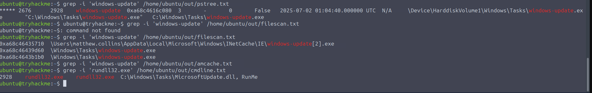
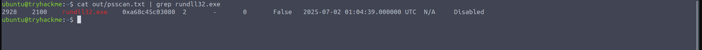
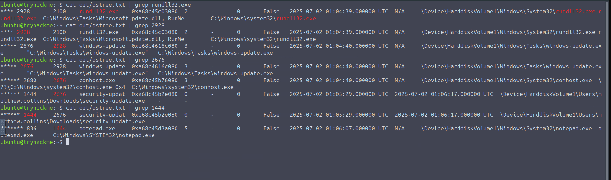
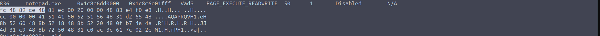
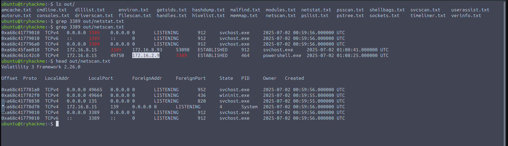

# Lost in RAMslation

| Field | Details |
|---|---|
| **Room** | Lost in RAMslation |
| **Difficulty** | Hard |
| **Duration** | 60 min |
| **Link** | https://tryhackme.com/room/lostinramslation |
| **Path** | Advanced Endpoint Investigations |
| **Module** | Module 8 — Honeynet Collapse |
| **Access** | Premium-only |

---

## Overview

The third room of the **Honeynet Collapse** module moves the investigation to **memory forensics**. After the Linux honeypot compromise (Initial Access Pot) and the Windows credential theft and lateral movement (Elevating Movement), the focus here is stage **#3** of the DeceptiTech network diagram: the memory dump of the DMZ gateway server `SRV-DMZ-GW`.

For a SOC/blue team analyst, the room shows how a single RAM image can reconstruct an intrusion: the initial payload and its command line, the process that launched it, the processes it spawned, injected Meterpreter shellcode, and the network evidence of lateral movement over RDP (port 3389).

---

## Task 1 — Introduction

DeceptiTech is a fast-growing cyber security company specializing in honeypot development and deception technologies. Its **DeceptiPots** are lightweight, configurable honeypots that can be installed on any OS to capture malicious activity.

The internal network is a traditional on-premises **Active Directory** domain with approximately 50 active users. The product platform is isolated and hosted entirely in the AWS cloud.


**The scenario:** One ordinary morning, DeceptiTech's entire network collapsed. Within minutes, all critical on-premises systems were locked down and encrypted. IT hurried to restore backups, while the security team went to their SIEM — only to find the backups corrupted and all SIEM data wiped clean.

This room covers the **third attack stage (#3 on the network diagram)**. As part of an external DFIR unit, the goal is a full-scope investigation explaining how the attack started.

---

## Task 2 — The Challenge

### Scenario

> *"I just need one solid answer, not ten theories"* — the project manager.

The logs for `SRV-DMZ-GW` looked normal, but the engineering team kept reporting odd slowdowns. Matthew was lost chasing the process responsible for the issue.

### Analysis Approach

| Item | Details |
|---|---|
| **Evidence** | Memory dump `SRV-DMZ-GW-evidence.mem` in `/home/ubuntu/` |
| **Access** | Use `sudo` to access the dump from the `analyst` account |
| **Timeframe** | Wednesday, Day 6 |
| **Threat** | Appears from the `SRV-IT-QA` host and targets the `SRV-DMZ-GW` server |
| **Connection** | SSH or Split Screen as `analyst` |

**Tips and tools from the room:**
- Threat actors tend to mimic system applications.
- Volatility is installed on the analyst's machine.
- Some output has been prefetched in `/home/ubuntu/out`.

> 💡 **Tip:** The room's hint that attackers mimic system applications is a general hunting principle — compare every process name, path, and parent against what is legitimate for that host.

---

### Q1 — What is the absolute path to the initial malicious file executed on this host?

```
C:\Windows\Tasks\MicrosoftUpdate.dll
```



> 🔴 **Attacker relevance:** The file name imitates a legitimate update component, matching the room's tip that threat actors mimic system applications.

---

### Q2 — Which process ID (PID) was assigned to the process used to execute the initial payload?

```
2928
```



---

### Q3 — What was the full command line used by the attacker to launch initial execution on this host?

```
rundll32.exe  C:\Windows\Tasks\MicrosoftUpdate.dll, RunMe
```


> 🔴 **Attacker relevance:** The command line shows the DLL being run through `rundll32.exe` with the `RunMe` entry point.

---

### Q4 — The attack launched various processes. What is the name of the final process in the chain?

```
notepad.exe
```



---

### Q5 — What are the first five bytes (in hex, e.g., 4d5a9000) of the Meterpreter shellcode injected into it?

```
fc4889ce48
```



> 🔴 **Attacker relevance:** The question frames this shellcode as injected into the final process in the chain (Q4), so a benign-looking process can host malicious code.

---

### Q6 — Which is the IP address that the hosts perform a lateral movement using port 3389?

```
172.16.2.9
```



> 📌 **Cross-room note:** Port 3389 is RDP, the same protocol seen in the stage #2 Windows investigation (Elevating Movement) of this module.

---

## Reconstructed Timeline

No timestamps are provided in the notes, so events are listed in the logical order of the questions.

| Step | Event | Detail |
|---|---|---|
| 1 | Initial payload executed | `C:\Windows\Tasks\MicrosoftUpdate.dll` launched via `rundll32.exe  C:\Windows\Tasks\MicrosoftUpdate.dll, RunMe` (Q1, Q3) |
| 2 | Executing process | PID `2928` (Q2) |
| 3 | Process chain | Various processes launched; final process is `notepad.exe` (Q4) |
| 4 | Shellcode injection | Meterpreter shellcode in `notepad.exe`, first five bytes `fc4889ce48` (Q5) |
| 5 | Lateral movement | Port 3389 activity involving `172.16.2.9` (Q6) |

---

## Findings Summary

| Question | Finding |
|---|---|
| Initial malicious file | `C:\Windows\Tasks\MicrosoftUpdate.dll` |
| Executing process PID | `2928` |
| Launch command line | `rundll32.exe  C:\Windows\Tasks\MicrosoftUpdate.dll, RunMe` |
| Final process in chain | `notepad.exe` |
| Meterpreter shellcode, first five bytes | `fc4889ce48` |
| Lateral movement IP (port 3389) | `172.16.2.9` |

---

## Key Takeaways

- A memory image of a server that "looked normal" in logs can still expose the full execution chain, injected code, and network connections.
- Masquerading is common: a file named like an update component and a benign process like `notepad.exe` can hide malicious activity.
- Capturing the full command line (not just the process name) reveals the DLL path and entry point used for execution.
- Injected shellcode can be identified by its leading bytes, a useful artifact for detection and triage.
- Port 3389 connections in memory help trace lateral movement to other hosts.

---

*Write-up by OPT4RUN*