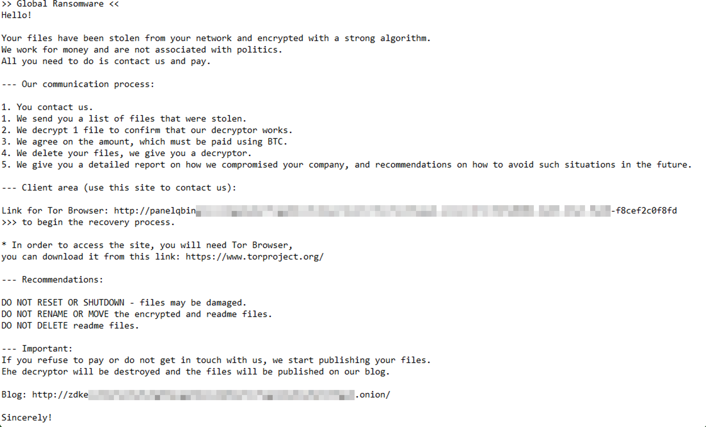
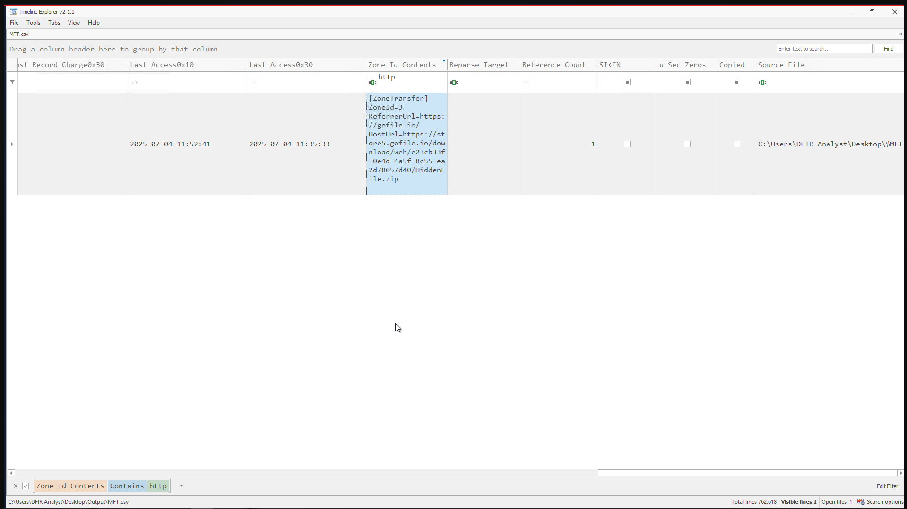
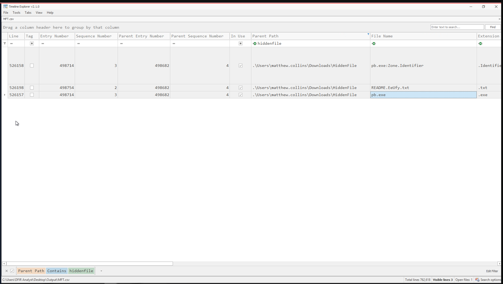
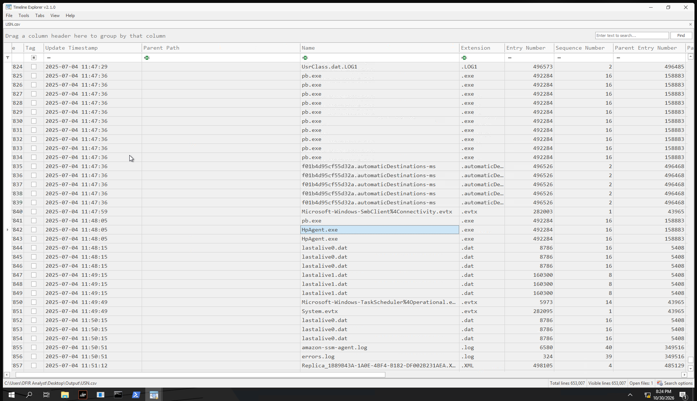
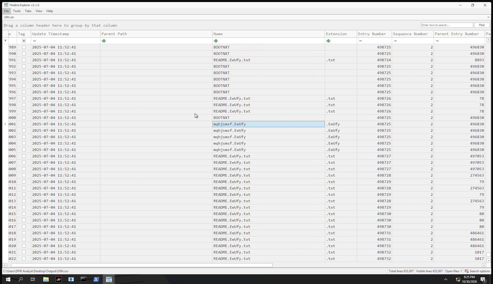

# Shock and Silence

| Field | Details |
|---|---|
| **Room** | Shock and Silence |
| **Difficulty** | Hard |
| **Duration** | 60 min |
| **Link** | [https://tryhackme.com/room/shockandsilence](https://tryhackme.com/room/shockandsilence) |
| **Path** | Advanced Endpoint Investigations |
| **Module** | Module 8 — Honeynet Collapse (stage #5, File System part) |
| **Access** | Premium |

---

## Overview

This is the fifth room of the **Honeynet Collapse** storyline. The earlier rooms covered the intrusion chain; here the attack reaches its destructive end: ransomware is deployed on the domain controller **DC-01**, and the only available evidence is a **partial disk image acquired after the encryption**.

The room is relevant to SOC and DFIR analysts because it practises reconstructing a ransomware event from **file system artifacts alone** (NTFS logs), with no SIEM data to lean on. The five questions walk through the full ransomware story: where the payload came from, what it was originally called, which executable started the encryption, what the encrypted files look like, and which group is responsible.

---

## Task 1 — Introduction

DeceptiTech is a fast-growing cyber security company specializing in honeypot development and deception technologies. Its products, **DeceptiPots**, are lightweight, configurable honeypots that can be installed on any OS.

The internal network is a traditional on-premises Active Directory domain with roughly 50 active users. The product platform is isolated and hosted entirely in AWS.


One ordinary morning, the entire network collapsed: all critical on-premises systems were locked down and encrypted, the backups were corrupted, and all SIEM data was wiped. This room covers the **fifth attack stage (#5 on the network diagram)**.

---

## Task 2 — The Challenge

### Scenario

Logan Hall rolled out new Group Policies to the **DC-01** domain controller on a Friday. When he connected remotely, most files on the server had an unfamiliar extension and were unreadable, and a ReadMe file sat on the Desktop. He reported the incident, and the only available evidence is a **partial disk image of DC-01 acquired after the encryption**.



| Detail | Value |
|---|---|
| **Day** | Friday, Day 8 |
| **Source of the threat** | `SRV-CRM-01` |
| **Target** | `DC-01` |
| **Connection** | RDP (as `DFIR Analyst`) |
| **Resources** | `C:\Users\DFIR Analyst\Desktop` |
| **Disk image (NTFS logs)** | `.\Artifacts\DC-01-NTFS-Logs.ad1` |
| **Analysis tools** | `.\DFIR-Tools\*` |

> 📌 **Cross-room note:** the threat originates from `SRV-CRM-01`, the host investigated in the previous room, **CRM Snatch** (stage #4).

---

### Q1 — What is the full URL from which the ransomware was downloaded to the system?

```
https://store5.gofile.io/download/web/e23cb33f-0e4d-4a5f-8c55-ea2d78057d40/HiddenFile.zip
```



> 💡 **Tip:** the payload was delivered as a ZIP archive named `HiddenFile.zip`, so the archive and the executable inside it have different names. Search for both when hunting.

---

### Q2 — What was the original file name of the ransomware executable downloaded to the host?

```
pb.exe
```



---

### Q3 — Which executable file initiated the encryption process on the system?

```
HpAgent.exe
```



> 🔴 **Attacker relevance:** the executable that started the encryption (`HpAgent.exe`) has a different name from the originally downloaded file (`pb.exe`). The notes do not state how the two are related, so no link between them is asserted here.

---

### Q4 — What file extension was appended to the encrypted files?

```
EeUfy
```



> 💡 **Tip:** an appended extension is a useful scoping indicator. It lets you list affected files quickly and estimate the blast radius.

---

### Q5 — Go beyond the obvious: which ransomware group targeted the organisation?

```
BlackLock
```

---

## Reconstructed Timeline

No timestamps exist in the notes, so the events are listed in the logical order of the questions.

| # | Event | Evidence |
|---|---|---|
| 1 | Threat appears from `SRV-CRM-01` and targets `DC-01` | Scenario |
| 2 | Ransomware archive `HiddenFile.zip` downloaded from `store5.gofile.io` | Q1 |
| 3 | Original ransomware executable is `pb.exe` | Q2 |
| 4 | `HpAgent.exe` initiates the encryption process | Q3 |
| 5 | Files on `DC-01` are encrypted and given the `EeUfy` extension | Q4 |
| 6 | Ransom note left on the Desktop; activity attributed to **BlackLock** | Scenario, Q5 |

---

## Findings Summary

| Question | Finding |
|---|---|
| Download URL | `https://store5.gofile.io/download/web/e23cb33f-0e4d-4a5f-8c55-ea2d78057d40/HiddenFile.zip` |
| Original executable name | `pb.exe` |
| Executable that started encryption | `HpAgent.exe` |
| Encrypted file extension | `EeUfy` |
| Ransomware group | BlackLock |

---

## Key Takeaways

- **File system artifacts can carry a ransomware investigation** even when logs and SIEM data are gone: the download source, executable names and encrypted extension all came from the disk image's NTFS logs.
- **Track every name a payload goes by.** The archive (`HiddenFile.zip`), the original executable (`pb.exe`) and the process that started encryption (`HpAgent.exe`) are three different names for the investigation.
- **Record the URL and file-hosting domain** (`store5.gofile.io`) as indicators: they support blocking, hunting and scoping.
- **Use the appended extension** (`EeUfy`) to scope affected files, and treat the ransom note and extension as inputs for attribution.
- **This room is the destructive end of the Honeynet Collapse chain**, following the compromise of `SRV-CRM-01` in the previous room.

---

*Write-up by OPT4RUN*